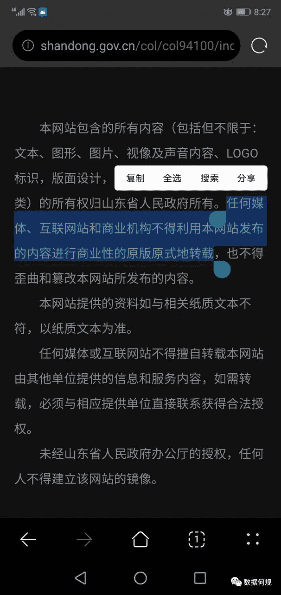

# 爬取政府公开网站数据的合规性

> 来源：[https://docs.feishu.cn/docx/X0T7dd6v0oKw2ixKJXxcD56NnYd](https://docs.feishu.cn/docx/X0T7dd6v0oKw2ixKJXxcD56NnYd)

**-问：**像政府官网上通常在网站声明板块，有禁止未经允许的商业化转载的声明，是否同时也意味着声明了禁止通过爬虫技术抓取该网站上的公开信息呢？

**-答1：**不一样，一般而言，看“网络爬虫排除标准”（Robots Exclusion Protocol）。有个robots.txt 文本告诉你哪些是不给爬的。还有一些就是分内外网，是否公开的那种，一般最好不要爬政府内网的东西，如果确有需要，务必再三确认。没有的话看是否需要公开的文本信息，以及你们爬取后的使用形式及范围，是否属于他限制使用的那一类。仅转载，问题不大，但是有些网站转过去，不标作者出处，打包付费下载或者付费阅读，那种就典型不行。

**-答2：**这句话应该是在保护他的著作权吧。详见：涉“网络爬虫非法抓取电子书”侵犯著作权罪案

**-追问：**行政处罚、评级等依法行政的公开信息，政府是否享有著作权呢？

**-答3：**我理解得先对作品的性质进行判断，属不属于《著作权法》五条规定的具有立法行政或司法性质的文件。公开的行政处罚这种应当属于。

> 本法不适用于：

> （一）法律、法规，国家机关的决议、决定、命令和其他具有立法、行政、司法性质的文件，及其官方正式译文；

> （二）单纯事实消息；

> （三）历法、通用数表、通用表格和公式。

> 《著作权法》第5条

然后再看是不是合理使用和法定许可的范畴，他这个声明有点事先排除合理使用的意思 。合理使用这块国内有点混乱   首先按版权法规定，法24 里有一些规定，“但著作权人声明不许...的除外”。但是也有人认为，国内没有合理使用的一般性条款，这跟TRIPs里的三步法对不上，对于不属于那12+1的情况，是不是可以考虑按三步法另行判断。

**-答4：**可以去看下企查查这类公司官网，对爬取数据来源合法性的说明

**-答5：**这块一般落入反不正当竞争的裁判 有不少案例的。著作权保护路径一般要求很高，较难证明。

**-答6：**他这竞争法有个小问题啊，被爬的是政府网站的话，谁来当适格的诉讼主体呢。目前反不正当竞争的经典裁判案例一般都是互联网平台之间的案例吧，比如百度诉360、大众点评诉百度。详见：北京微梦创科与北京字节跳动不正当竞争纠纷案。

**-答7：**可能还要考虑刑事风险，网站爬瘫了，可能就非法入侵计算机信息系统罪了。

> 案例 ：李某等非法侵入计算机信息系统罪(2018)川3424刑初169号法院查明：被告人李某使用“爬虫”软件，大量爬取全国各地及凉山州公安局交警支队车管所公告的车牌放号信息，之后使用软件采用多线程提交、批量刷单、验证码自动识别等方式，突破系统安全保护措施，将爬取的车牌号提交至“交通安全服务管理平台”车辆报废查询系统，进行对比，并根据反馈情况自动记录未注册车牌号，建立全国未注册车牌号数据库。之后编写客户端查询软件，由李某通过QQ、淘宝、微信等方式，以300-3000元每月的价格，分省市贩卖数据库查阅权限。

> 法院认为：本院认为，被告人李文某为牟取私利，违法国家规定，侵入国家事务领域的计算机信息系统，被告人的行为均已构成非法侵入计算机信息系统罪。

[技术风险](https://cbe8t1r4a5.feishu.cn/wiki/MYjVw1V1NiYcHOk1OxKchGuUnBb)