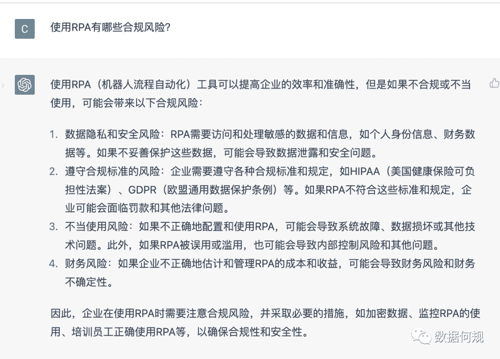
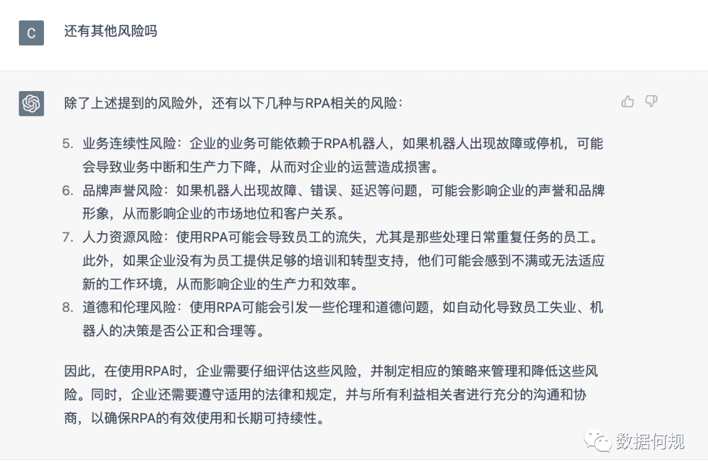
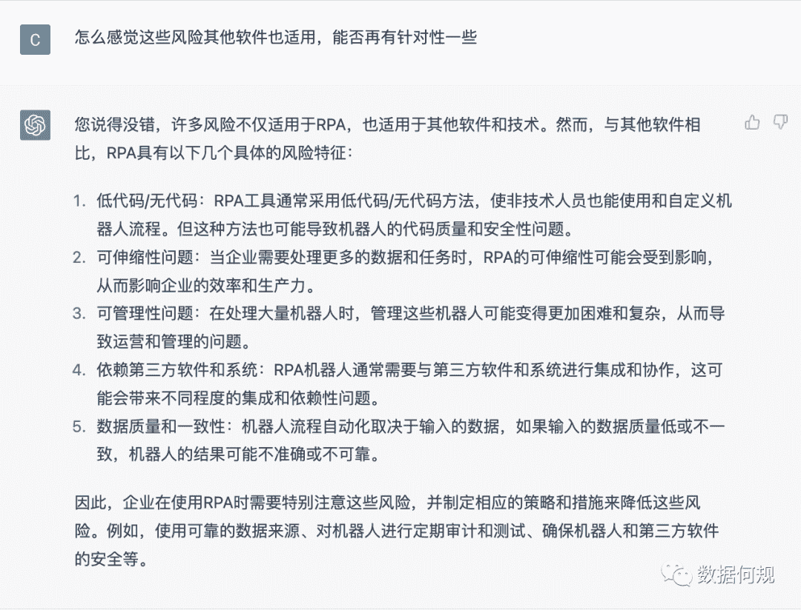

# RPA技术的合规风险

> 来源：[https://docs.feishu.cn/docx/ZKWYdN7T5orv1Ixp5k4cdXREnng](https://docs.feishu.cn/docx/ZKWYdN7T5orv1Ixp5k4cdXREnng)

**-问：**请问有人了解RPA技术吗？在客户授权后，客户在页面上填写目标网站的登陆信息（账户、密码），使用RPA技术，跟随客户进入目标网站，然后过去信息。使用这种技术行为的合法性如何？

**-答1：**合合信息在上交所问询函回复里有提到RPA技术，可参考。

**-答2：**可以看看这篇：RPA技术的安全性与RPA在网络安全领域的实践。

**-答3：**听一下Chat GPT的观点。

**总结：RPA的主要功能就是重复一些较为简单、具有重复性的事务，我感觉有**点类似鼠标精灵，再多一些逻辑。若赋予其一定权限，其失控后相关风险也就自然产生了。

[技术风险](https://cbe8t1r4a5.feishu.cn/wiki/MYjVw1V1NiYcHOk1OxKchGuUnBb)