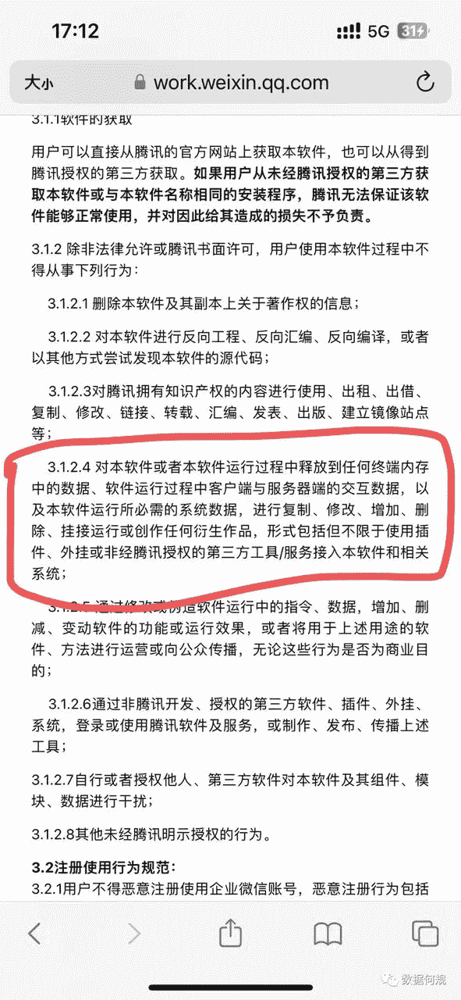

# 爬取客户微信昵称的合规性

> 来源：[https://docs.feishu.cn/docx/WVAsdXBRwox8EpxdRYmcUEyVnve](https://docs.feishu.cn/docx/WVAsdXBRwox8EpxdRYmcUEyVnve)

**-问：**我有个问题想问下 企业微信企业购买的服务 添加的客户好友 登陆账号后 企业可以采取爬虫方式爬取企微用户微信昵称吗？

**-答2：****好奇，企微在这方面会**有反爬虫措施吗，比如robots协议那些。

**-答3：**不知道会不违反这条。

**-答4：**针对某些读内存的作弊工具，比如cheatengine，另外 这一条应该也是很早拿来针对珊瑚虫之类的工具吧。cheat engine作弊器的原理就是通过读取内存数值然后强行修改该数值达到本地获取某些资源什么的（比如一键9999金币啥的。案例我倒是没特别关注过 但十几年前腾讯打击彩虹QQ插件的时候我猜是用类似的理由。

总结：严格说可能有问题，建议业务部门要做自己做，别问。

[技术风险](https://cbe8t1r4a5.feishu.cn/wiki/MYjVw1V1NiYcHOk1OxKchGuUnBb)