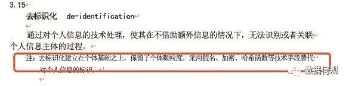

# Hash处理过的个人信息匿名化了吗

> 来源：[https://docs.feishu.cn/docx/CCwKdaIVQojvUlxkugpcsOu7nIe](https://docs.feishu.cn/docx/CCwKdaIVQojvUlxkugpcsOu7nIe)

**-问：**各位大佬，请教一个问题，请问用Hash哈希技术处理过的个人信息算匿名化信息吗？

**-答1：**是去标识，如果算完哈希就能随便给出去[，业务部门可以笑死。之前](http://mp.weixin.qq.com/s?__biz=MzU1MzAzNzcwNw==&mid=2247484738&idx=1&sn=8ce7427ed74a10b3af72d8d9ee580a3b&chksm=fbf9bfa6cc8e36b00a710a15cec0535bdecb3327a3030bec427632de78dcc7f711ebf9eaf88a&scene=21#wechat_redirect)有过讨论：（1）煮酒言规 | 第001期；（2）法务如何用Chat GPT和业务Battle。

**-答2：**35**273有说明的。《个人信息保护法》去标识化的定义未明确“去”的**是什么。国家标准《信息安全技术 个人信息安全规范》（GB/T 35273-2020，下称“个人信息安全规范”）第3.15条注释，“去标识化建立在个体基础之上，保留了个体颗粒度，采用假名、加密、哈希函数等技术手段替代对个人信息的标识。”根据上述规定，去标识化“去”的是“标识”，对于“标识”的理解，可以参考《信息安全技术 个人信息去标识化指南》（GB/T 37964-2019，下称“个人信息去标识化指南”）第3.3条在定义去标识化时的注释，即“去除标识符与个人信息主体之间的关联性”。标识符可以实现对个人信息主体的唯一识别。

**总结：35273，YYDS。**

[加密/算法](https://cbe8t1r4a5.feishu.cn/wiki/NXqDwGrCvil4g6kux7LcsLbCnMb)

[去标识化](https://cbe8t1r4a5.feishu.cn/wiki/wikcnBAu86hhXoSNR49Ne8sDRAc)