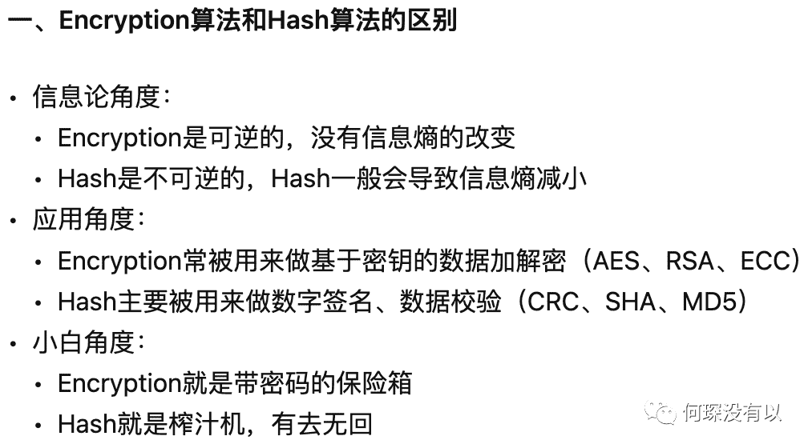

# 哈希算法是加密算法吗

> 来源：[https://docs.feishu.cn/docx/SvIZdxKwSobVGFxSVeEcMUJHnsg](https://docs.feishu.cn/docx/SvIZdxKwSobVGFxSVeEcMUJHnsg)

**-问**：哈希算法是加密算法吗？

**-答1：**哈希其实算**加密算法**的。只不过**没法解密**。**彩虹表**攻击可以用来爆破。MD5算法因为天然缺陷，沦陷了，网安等各类监管或者评测认证都不认可MD5算法。现在都是用SHA256摘要算法。但是我们基本上也会加个salt盐值，否则还是容易被匹配。salt可以理解为密钥。这样的好处是大家尽管都用sha256摘要算法，但是因为各自salt不同，哪怕原值一样，算出的hash值也不一样。

**-答2：**哈希（散列）和加密都是**算法**，都不都是**加密算法**。暴力破解不等于密码学意义上的解密。详见：https://zhuanlan.zhihu.com/p/20064358

关于加盐哈希，可以看看这篇：https://www.cnblogs.com/makai/p/11130703.html

**-答3：**要用通用的**彩虹表****来破解哈希前**的明文，随着哈希算法迭代，成本是非常高的，基本不太可行。但在特定环境下，彩虹表还是比较好用。例如我知道这一批是对手机号的哈希，且没有加盐哈希，那不管用什么哈希算法。先遍历一遍所有的手机号用同样的哈希算法计算下，用这个生成的数据库反查原始的明文手机号。因为原始数据集不是很大，这个数据库生成时间就比较能接受了。

**-答4：****虽然彩虹表攻击和暴力破解有些类**似，但我认为二者还是有些区别，不能将彩虹表完全等同于暴力破解。

暴力破解：可简单理解为“猜密码（口令）”，例如，登录某系统时，已知（假设）用户名为admin，不知口令的情况下，将各种可能的口令输入进行尝试（可利用一些相关的信息经各种组合、处理，构造成一个字典），直至尝试成功。当然，通常系统会加上验证码、账号锁定等风控机制。（当然，也有一些能绕过一般验证码的技术，攻防较量）

彩虹表攻击：先将各种有可能的信息拿到，然后用某哈希算法全部计算一遍得出一堆对应的哈希值（彩虹表）。然后，再用彩虹表中的哈希值逐一去目标中尝试，若命中，则反查彩虹表中对应的原始值。如果考虑“哈希碰撞”的话，那么即便是哈希值查到了，原始值也不一定对得上号哦，虽然这种概率非常低（即A和B用同样的哈希算法运算后的结果竟然是一样的）。

详见：https://www.cnblogs.com/lsdb/p/10038835.html

这张图特别好

[加密/算法](https://cbe8t1r4a5.feishu.cn/wiki/NXqDwGrCvil4g6kux7LcsLbCnMb)

[去标识化](https://cbe8t1r4a5.feishu.cn/wiki/wikcnBAu86hhXoSNR49Ne8sDRAc)