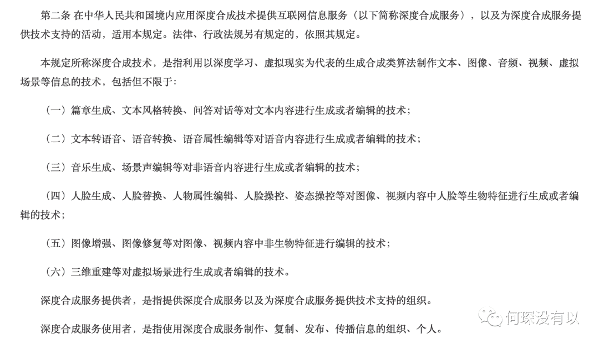
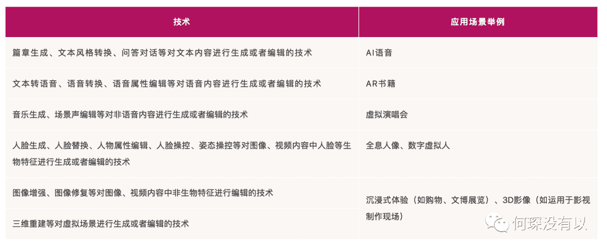
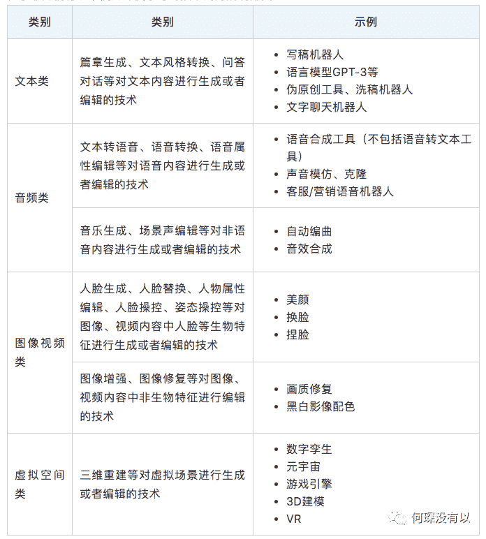

# 深度合成服务提供者和使用者的区分

> 来源：[https://docs.feishu.cn/docx/VNIIdHI9qotnC2xkiXMcB6bwnur](https://docs.feishu.cn/docx/VNIIdHI9qotnC2xkiXMcB6bwnur)

**-问：**关于《互联网信息服务深度合成管理规定（征求意见稿）》，公司的AI客服（语音+文字）不属于应用深度合成技术提供互联网信息服务吧？

**-答1：**根据定义以及几位律师的解读，我咋觉得应该属于呢？

图片来源：[虚拟向左，治理向右——快谈《互联网](https://mp.weixin.qq.com/s?__biz=MzA5MTA3ODc1Mw==&mid=2649830145&idx=3&sn=c1b6013671b402b6f19020e96d718f0a&scene=21#wechat_redirect)信息服务深度合成管理规定（征求意见稿）》

图片来源：[虚拟空间的合规拼图：《互联网信息](https://mp.weixin.qq.com/s?__biz=MzI4MzQwMTQ2MA==&mid=2247485191&idx=1&sn=c06cd089e11cc79acc59c1b329d34710&scene=21#wechat_redirect)服务深度合成管理规定（征求意见稿）》发布

**尽管**两位律师对AI客服属于文本类还是音频类有所分歧，但无论如何都是属于“深度合成算法”的。

**-追问：**深度合成技术是公司自己用，**没有提供给客户**用啊。没有提供“互联网信息服务”，说得通吗？特别是第2条还区分了提供者和使用者。

**-答1：**如果单纯是使用这项技术，那么仅是使用者，只要不是自己开发就好。

**-追问：**自己开发自己使用，没有提供给其他主体使用，应该不用履行提供者的各项合规义务吧？

**-答1：**我觉得还是要落实的，比如这个算法肯定要求做备案。如果按照这个逻辑，抖音也可以说，我算法是自己开放的，也是供APP自己使用，就不用受到监管了。

**-追问：**深度合成算法和推荐算法还不太一样，推荐算法天然是开发者自己用的，所以算法推荐规定没有区分提供者和使用者，但是深度合成区分了两种身份。史律师在文章中也认为，这个问题有待讨论。

> 征求意见稿将服务提供者视为类似社交媒体平台的角色，有义务对平台内的用户行为进行监督。但是，在现实中深度合成服务提供者的技术同样依赖于第三方的提供，如可能会需要使用外部的引擎来支持自己的服务，在这样的场景下，如何定位各方的主体角色可能是需要推敲论证的，可能更应该将之视为征求意见稿之外的技术开发者，而非服务提供者更加合适。

> 史宇航，👸号：送法上网[虚拟空间的合规拼图：《互联网信息](https://mp.weixin.qq.com/s/0VWJGfCNZ2hc0zu9Bfkntw)服务深度合成管理规定（征求意见稿）》发布

**-答2：**对**于自己开发自己使用的情形，说不定属于提供者+使用**者，两边的义务都跑不掉。对于史律师文章中的这段话，举个例子，可以是：某人工智能公司A，用了在B公司开源的深度学习引擎X开发了AI客服甲，然后卖给C公司使用。

**-答1：**我觉得B也是“深度合成服务提供者”，属于其中的“深度合成服务提供技术支持的组织”？而A公司可能也同样是“深度合成服务提供技术支持的组织”。A+B，需要履行完整的“深度合成服务提供者”义务？

**-答2：**有可能，但毕竟只是征求意见稿。

**-答3：**服**务**提供者包含了面向用户提供合成服务的服务提供方，和提供技术支持的技术提供方，当公司是自己研发算法自己提供合成服务，则主体归一了；但如果是公司外采的供应商的，则是两个主体，但意见稿并没有将服务方与技术方区分来说，所以对于二者分离的，各自领什么合规义务有一定的操作困难。而使用者就是具体使用合成服务的用户。

**-答1：**对，如果是后者，两个人加起来的义务，肯定也得和自主研发的义务一样。不然就不公平了。法规可能不会说，哪个义务技术方做，哪个义务服务方做。反正该做都得做，谁来做你们合同自己约定清楚吧。

**-答3：**参与立法的学者说还是**可以区分**的，大体是面向用户的，比如身份真实认证、内容可追溯、公示服务规则和备案，由服务提供者去做；算法底层的，比如确保训练数据合法，由技术提供者去做；信息安全主体责任、内容显著标识、备案，双方都要做。

**-答4：**如果是接类似GPT-3这样的模型，理论上是否对OpenAI这样的公司（虽然企业自身确实有一些确保算法可问责的安排，但未必与此处一致）也科有责任。

**-追问：**这里的最后一个责任是指 算法开发方也需要 “用户管控”而负责吗。

**-答4：**没有，只是承继前面提到的例子，尝试考虑了一个比较具体的主体B。也许同样值得思考的另外一个例子是：数名隶属于某域内或域外单位的研究者研究得到某相关算法，并将相应论文和代码开源于arXiv和GitHub，随后出现了A和C。这个故事应该不算鲜见。此时，得否科以相应的责任和义务，以及境外主体是否可以受到有效的监管。

**相应制度正尝试的**、对主体类型的有趣划分，或许也可以在欧盟AI Act提案的相应划分下去比较（User/Provider，唯之间定义及相应责任义务仍有些许不同。且AI Act引入了一类Importer主体，以部分纳入域外主体）。涉个人信息时，另一或许同样非常有趣的角度，是从处理者的角度出发，代入处理目的为（特定场景下的）生成、合成或编辑，方式为深度合成（或加工/自动化处理等），再比较或可相应得到的责任义务是否与此一致。

**科普：**

> GPT-3 (Generative Pre-training Transformer-3)是一个自回归语言模型，目的是为了使用深度学习分类或产生人类可以理解的自然语言。GPT-3是由在旧金山的人工智慧公司OpenAI训练与开发，模型设计基于谷歌开发的变换语言模型。GPT-3的神经网路包含1750亿个神经，为全世界参数最多的神经网路模型。

> 维基百科

被网友誉为「神迹」的 GPT-3 到底是什么？

一文解答你对GPT-3的好奇！GPT-3是什么？为何说它如此优秀

GPT-3 是「暴力美学」的一次胜利

[AI](https://cbe8t1r4a5.feishu.cn/wiki/wikcntdefWZIuNZgDEusD7jvRBf)