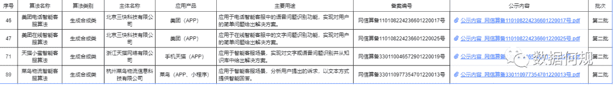
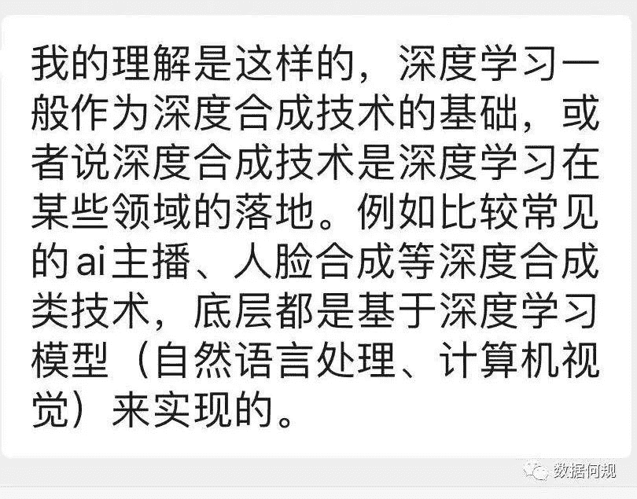

# 深度合成技术的认定

> 来源：[https://docs.feishu.cn/docx/Uviyd8fy0o6BCLxA3bJcUIpSngb](https://docs.feishu.cn/docx/Uviyd8fy0o6BCLxA3bJcUIpSngb)

**-问：**语音识别工具属于深度合成服务吗，类似于siri、小度这种。

**-答1：**TTS算的，现在语音合成工具（尤其是微软做的）很接近真人的了。特别是抖音和b站的各种短视频的配音。

**-答2：**一般来说语音服务会有两个环节，语音转文字这个环节应该不算，后续的语音合成才算吧。

**-追问：**我好奇的是，APP有智能客服或者打电话用智能客服，要适用深度合成新规吗？这种场景下APP方应该属于新规中的“深度合成服务使用者”吧？

**-答3：**如果是采购服务的话，我觉得机构只是使用者。自研的自己去做，采购的供应商做？是这个逻辑不。自研的不对外卖，仅自用。。算提供者吗。

**-答4：**不一定，但可以看看算法备案的材料。很多智能客服系统做了算法备案。

**-答5：**备案这几个的确就是我们刚才讨论的自用智能客服场景，那有多大几率被作为“深度合成服务提供者”进行监管呢？如果纳入，很多APP都要瑟瑟发抖了。

**-追问：**深度学习跟深度合成，区别和联系是啥呢？困惑。

**-答6：**深度学习是方式，深度合成是结果。

**-答7：**是不是应该限定在合成后的内容是否可以和真人（做的）混淆来界定这个范围啊，不然只要用了深度学习算法的东西那就可太多了。

**-答8：**一个理工科朋友的解答。

**-答9：**前端和后台么。

**-答10：**按他的逻辑 苹果拟我表情 算吗。

**-答11：**我仔细看了看这个介绍，觉得算。通过 iPhone 自带的信息 App，可以创建拟我表情和符合您性格和心情的个性化拟我表情贴纸包来表达自我。需要在 iPhone X 以上的机型配备原深感摄像头的机型上，您可以发送动态的拟我表情信息，还能录制您的声音并模仿您的面部表情。

**-答12：**举个典型例子 b站有个up叫上海小马哥 里面用的人物形象应该就是基于拟我的二创 用的也是深度合成。

[AIGC](https://cbe8t1r4a5.feishu.cn/wiki/wikcntdefWZIuNZgDEusD7jvRBf)