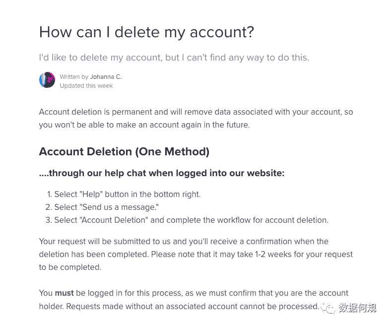
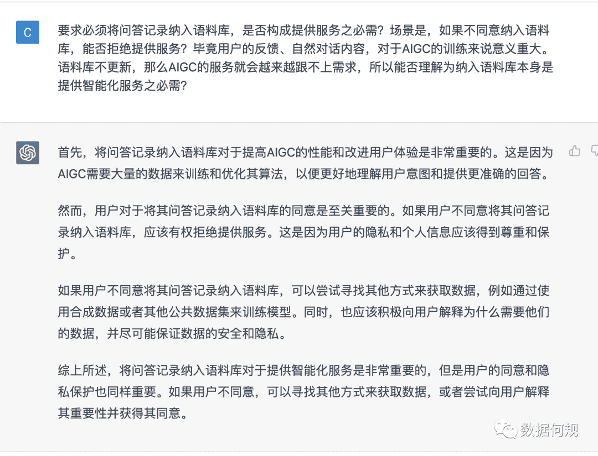
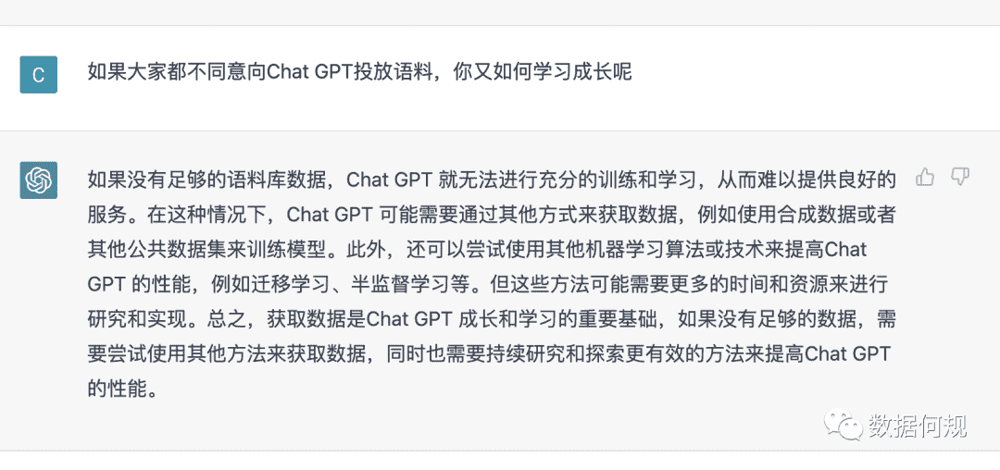

# 问答加入AIGC语料库是提供服务所必需吗

> 来源：[https://docs.feishu.cn/docx/SXQed5COaoBmSRx7SCGcZOvQnxb](https://docs.feishu.cn/docx/SXQed5COaoBmSRx7SCGcZOvQnxb)

**-问：**要求必须将问答记录纳入语料库，是否构成提供服务之必需？场景是，如果不同意纳入语料库，能否拒绝提供服务？毕竟用户的反馈、自然对话内容，对于AIGC的训练来说意义重大。语料库不更新，那么AIGC的服务就会越来越跟不上需求，所以能否理解为纳入语料库本身是提供智能化服务之必需？

**-答1：**写到隐私政策里面告知同意就好吧，不需要单独同意，但如果用户撤回同意了怎么办，很麻烦。按中国法规，不能拒绝提供服务，但如果大家都不同意，也就没有语料库了。不过Chat GPT确实有删除功能。

**-答2：**这个能否类推到所有基于AI的产品？比如扫地机器人，某品牌会默认同意，但给了用户关闭权。

**-答3：**也是基于公共利益的考量。把场景放到各个平台智能客服中，就相对好解释。毕竟收集客户的问题和反馈，是为了解决客户当前提出的具体问题，作为提供服务之必需来说没跑。Open AI确实也在《Terms of Use》中如此明确了：

(c) Use of Content to Improve Services. One of the main benefits of machine learning models is that they can be improved over time. To help OpenAI provide and maintain the Services, you agree and instruct that we may use Content to develop and improve the Services. You can read more here about how Content may be used to improve model performance. We understand that in some cases you may not want your Content used to improve Services. You can opt out of having Content used for improvement by contacting support@openai.com with your organization ID. Please note that in some cases this may limit the ability of our Services to better address your specific use case.

> 规定用户同意ChatGPT使用用户内容改进和提升服务，说白了就是用用户来训练自己的机器学习算法，这一点对搜索引擎时代的算法也是如此，可以说这一条是保证ChatGPT越来越智能和越来越有竞争力的基础。这更详细的内容使用规则是以另一个单独文档《用户内容如何被用于提升系统性能》提供给用户的，该条同时指出如果用户不愿意自己的内容被chatgpt使用，可以通过邮件的方式表示拒绝，但这种做法可能导致用户在特定场景下的使用系统能力受到影响。这样的说法，不是完全的没有依据，毕竟很多个性化的服务是有赖于在互动中学习用户数据而实现的，这让我们联想到国内法律要求推荐算法要向用户提供非个性化的选项。

> 张延来，👸号：网络法实务圈看了ChatGPT的《使用条款》，确实有点东西

**-答4：**看看Chat GPT怎么说。

**总结：Open AI采取的是opt out即，发邮件可退出收集其对话，若每个人都这么**做，AI的强大又从何而来呢？不过从Chat GPT自己的回答来看，似乎问题不大。

[AIGC](https://cbe8t1r4a5.feishu.cn/wiki/wikcntdefWZIuNZgDEusD7jvRBf)