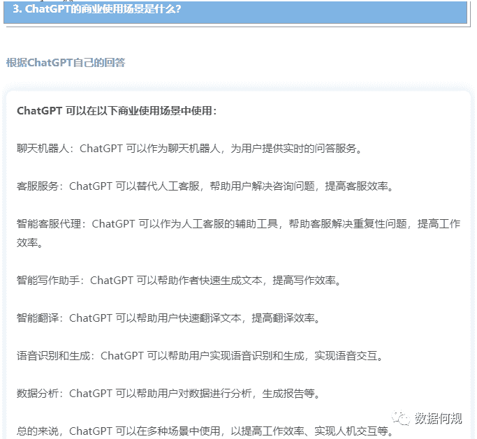
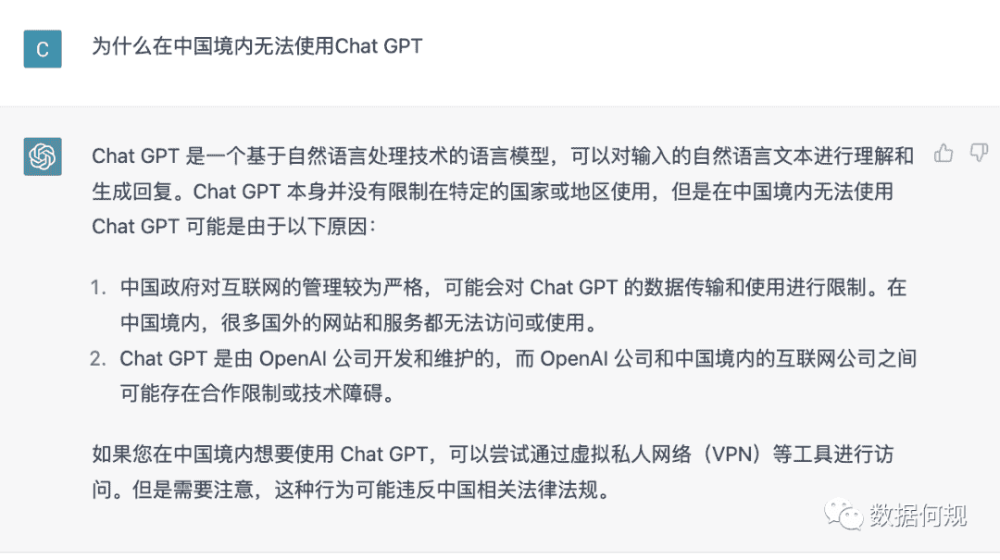
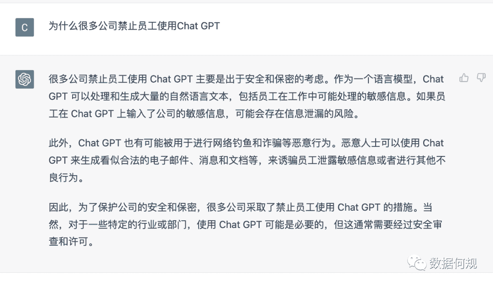

# 境内使用Chat GPT

> 来源：[https://docs.feishu.cn/docx/IMDsd1I5IoP98nxC1LKcZuzQnZd](https://docs.feishu.cn/docx/IMDsd1I5IoP98nxC1LKcZuzQnZd)

**-问：**我记得大家之前在群里面讨论过。ChatGPT国内监管是通知不让用的是么？

**-答1：**我理解，凡是需要🪜才能访问的都属于不让用。

**-答2：**这个能否类推到所有基于AI的产品？比如扫地机器人，某品牌会默认同意，但给了用户关闭权。

**-答3：**OpenAI独家回应｜ChatGPT为何不向所有中国用户开放注册？

**-答4：**公司如果有跨境专线，也不能用吗？

**-答5：**国内跨境专线，一般来说就是香港拉的。香港反正也不能用。

**-答6：**现在真的有公司打算应用Chat GPT。

**-答7：**有什么场景呢？

**-答8：**这是Chat GPT自己的回答。

**-答9：**chatgpt目前的防注入攻击好像还是不太行。。之前看了new bing被攻击后输出其项目代号和开发指南的故事。

**-答10：**主要是你的数据会喂给OPENAI啊，万一你司有啥敏感信息被喂了呢？

**-答11：**有公司已经提示了：不应在ChatGPT上提问或者反馈所有涉公司商业的信息；不应基于ChatGPT的问答完成工作需求。详见：多家科技巨头提醒员工：不要向ChatGPT泄露敏感信息；担心数据安全，摩根大通限制员工使用ChatGPT。

**-答12：**知识产权相关的问题也值得关注。

**-答13：**有以下几篇可以参考：（1）聊(Chat)嗨[勿忘合规--类ChatGPT应](https://mp.weixin.qq.com/s?__biz=MzA4NDMzNjMyNQ==&mid=2653299530&idx=2&sn=21d647a6bc7136f46ab94ee3834ecdd9&scene=21#wechat_redirect)用的法律合规要点；（2）可以用ChatGPT写的程序赚钱吗？——AIGC的基础法律问题透视；（3）ChatGPT出品：谁是作者？

**-答14：**Chat GPT的回答：

总结：想在境内基于商业用途使用Chat GPT阻碍很多。

[AIGC](https://cbe8t1r4a5.feishu.cn/wiki/wikcntdefWZIuNZgDEusD7jvRBf)

[数据出境定义](https://cbe8t1r4a5.feishu.cn/wiki/wikcn3L5bGEOvBTHYv21IniHZxc)