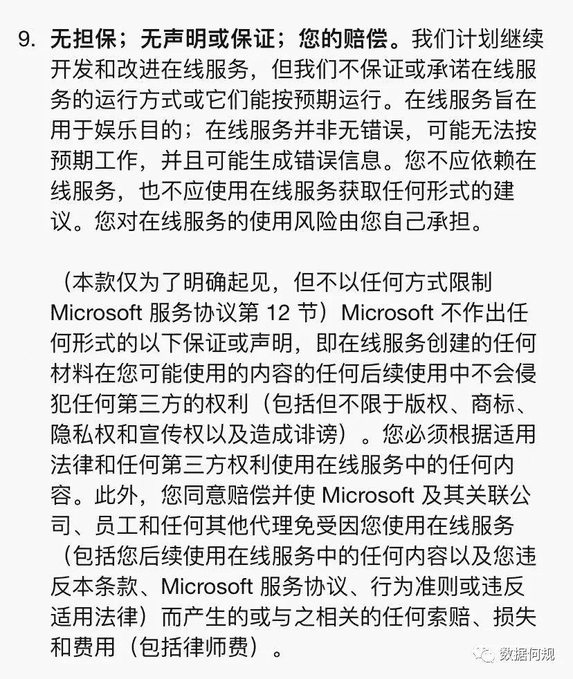

# 对AIGC供应商的资质要求

> 来源：[https://docs.feishu.cn/docx/C1uYdVe0woWeVwxAitqctEEKnpd](https://docs.feishu.cn/docx/C1uYdVe0woWeVwxAitqctEEKnpd)

**-问：**对于百度文心AI作画，大家觉得作为甲方公司要注意些啥？比如咨询乙方是否有资质？AI作画是否申请了算法备案？是不是要套算法服务和深度合成服务的法律法规要求？

**-答1：****训练数据集**是否有授权？

**-答2：**还有**知识产权**。

**-答3：**New Bing的回答都会注明来源知乎。但是知乎回答的版权是回答者自己啊。

**-答4：**一般找个数据公司采购，隔离一层风险吧。

**-答5：**收集的客户输入数据如何处理；**商业秘密**如何保护。

**-答6：**MS早就把自己撇清了。Newbing：用户自己要用的啊，版权别来沾边。

**-答7：**这个在软件和云服务也很常见，no warranty and indemnity。

总结：如何保证不泄密是最重要的关注点。

[AIGC](https://cbe8t1r4a5.feishu.cn/wiki/wikcntdefWZIuNZgDEusD7jvRBf)