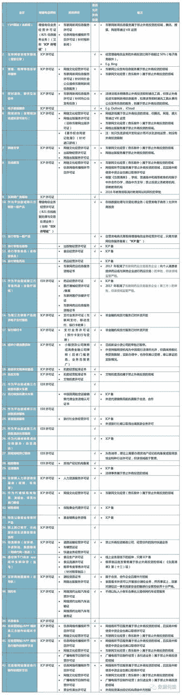

# 大模型所需资质

> 来源：[https://docs.feishu.cn/docx/P8e7dVtwHoEjcbxzKxjcKhXin0e](https://docs.feishu.cn/docx/P8e7dVtwHoEjcbxzKxjcKhXin0e)

**-问：**请教各位，如果需要做类似文心一言的模型，是不是需要做增值电信业务经营许可？参考过去讨论的ICP，大模型应该定义成什么服务，信息搜索服务吗？

**-答1：**是的，其他的拦路虎更多：**资质，备案，评估**。如果是通用场景的，云服务。如果是垂直场景的，按具体业务场景匹配。比如：教育的，科大讯飞星火。这是我们摸索出的，不代表适用你们当地监管要求。后面你会发现你问得这个根本不是个事，各种评估都是大项目。

**-答2：**顺着这个问题想问下 icp许可是最终的服务提供者去做呢 还是模型接口提供者需要 还是两者都需要呢？ 算法备案也一样？

**-答3：**无论是ICP还是都是评估，都是二者都要做。

**-答4：**那比如车企调用了文心一言模型接口 二次开发算法提供给用户  那车企是不是只要对我自己这部分的算法备案就行吧？

**-答5：****对的，主要现在文心**也没过双新，你商业化不了。国内所有的都是内测。

**-答6：**那接着这个问题，这种情况下是不是对二次开发部分的算法去做双新评估就可以了。

**-答7：**如果不是提供新闻信息服务，应该是推荐算法备案和双新评估吧。

**-答8：**双新评估的技术检测机构，有没有官方认证推荐过的那种呀。

**-答9：**https://www.isc.org.cn/article/10677996560969728.html（不负责转发）。

**-答10：**不一样，支撑单位都涉密。

**-答11：**是否具备舆论动员能力也非常tricky。

**-答12：**是的，这个定义很“艺术”。建议大家认真对照已经完成备案的场景，就会体会到“舆论属性和社会动员能力的互联网信息服务”的认定很宽泛，并是只从文字上直白理解或只看法条中明确列举的外延这么简单。

[AIGC](https://cbe8t1r4a5.feishu.cn/wiki/wikcntdefWZIuNZgDEusD7jvRBf)