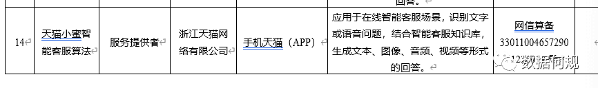
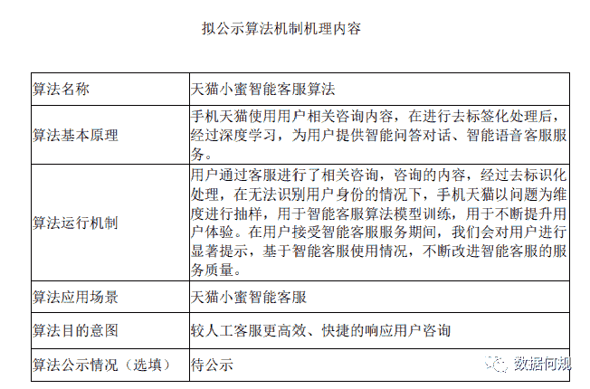
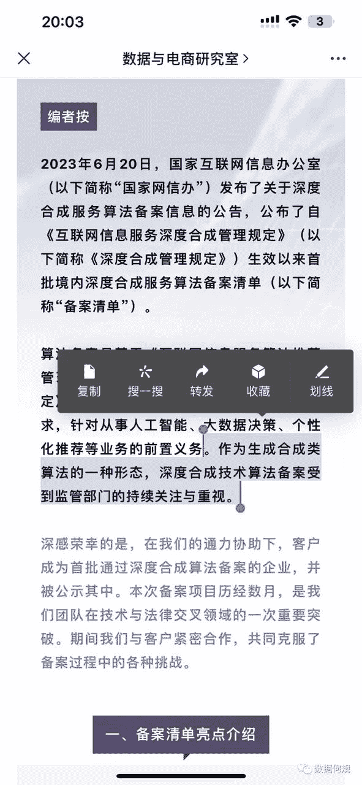

# 深度合成和算法生成的区别

> 来源：[https://docs.feishu.cn/docx/Ll14dJmAeo3TcgxBanEcRk4SnHb](https://docs.feishu.cn/docx/Ll14dJmAeo3TcgxBanEcRk4SnHb)

**-问：**深度合成的算法备案、和之前生成合成的算法备案，会有区别吗。

**-答1：**深度合成：n变1；生成：0-1。也不能说0到1，就是生成一个新的。之前问过我们同事，这两种算法的底层技术逻辑不一样，模型结构和评价指标不一样，所以备案的话，那个技术说明的文件肯定是不一样的。

**-答2：**刚刚发现天猫小蜜智能客服算法去年十月份做了生成合成类算法的备案，上次发的深度合成备案里也有它。不确定深度合成这个算法备案是不是和生成合成类算法备案用的一套自评估板子。

**-答3：**这么理解，生**成合成心****里**想**的是拼图**，深度合成想的是deepfake。-答4：从法律文本和实际应用来比较的话，深度合成技术的客体主要是算法，主要应用场景是深度伪造；生成式人工智能的技术客体包括算法、模型、规则，主要应用场景是文本图像的生成。-答5：中伦的文章是这么说的，把深度合成视为是生成合成的一个子分类。

**-答6：**看看这篇：我国生成式AI新规的认识和理解之一：和深度合成规则的主要异同。

**-答7：**简单而言，深度合成算法备案是生成合成类算法备案的子类，两者可以说具有一定的重叠关系，但还是有所区别：

1.备案对象不同：生成合成类算法备案面向对象是算法服务提供者；深度合成算法备案面向对象是算法服务提供者与技术服务提供者。

2.底层技术关注点不同：生成合成类算法服务是指自动或辅助生成、编辑文本、图像、语音、视频等网络信息内容的服务；而深度合成则是指用DL、VR等算法技术制作文本、图像、音视频等。

3.目前有关人工智能领域的概念较多，各概念范围还有待厘清。生成合成类、深度合成、生成式人工智能。目前能够从其概念和治理规则中看出，深度合成更强度创作性、伪造性，而一般的生成式人工智能的外延比较大。当然，这个各有说辞，有的说深度合成包括AIGC，有的说AIGC和深度合成重叠，总之说法不同。

[AIGC](https://cbe8t1r4a5.feishu.cn/wiki/wikcntdefWZIuNZgDEusD7jvRBf)