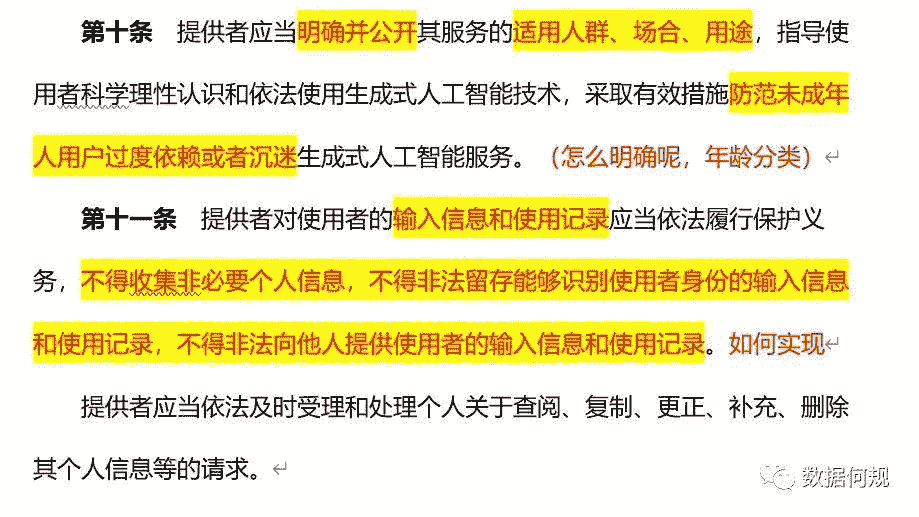

# AIGC新规最小化要求如何落实

> 来源：[https://docs.feishu.cn/docx/KhL4dKmQjosKMsxZI6GclyRhnKW](https://docs.feishu.cn/docx/KhL4dKmQjosKMsxZI6GclyRhnKW)

**-问：**最近《生成式人工智能服务管理暂行办法》出台，有一些问题还有点疑惑，希望有大佬帮忙解答一下。

办法第十条中的明确适用的人群、场合、用途，十一条是针对个人信息的“最小化”收集等要求。这个明确人群、场合、用途是否相当于个保法里面要求的明确信息收集的场景和用途？

以大模型为例，具有通用性特征，该如何明确？

**-答1：**这个明确人群、场合、用途是否相当于个保法里面要求的明确信息收集的场景和用途？不**太一样，**第十条前半部分强调用户使用协议，相当于企业的“免责”，通过用户服务协议说清楚模型的局限性和适用的场景，后半部分强调年龄验证，这个你可以蹲一蹲open AI回应意大利个人数据保护局的监管要求，看看他们怎么做。

**-答2：**办法第十条中的明确适用的人群、场合、用途，.......这个明确人群、**场合、**用**途是否相**当于个保法里面要求的明确信息收集的场景和用途？—不同，但又类似的透明度要求，前者主要通过结合产品或者服务的场景、用途等实际情况，通过用户协议或者单行的具体的使用指引啊 告知书啊、标识、告知等方式来实现，后者主要是隐私协议。

**在未成年人网络保护**里，做的比较好的，还有家长或监护人告知书，教育宣导小文档法律文书类外，技术层面还会提供家长一键锁定、时长控制等操作。

办法十一条，一般有**内容审核****管控**的**大企，都懂具体怎么做了，**例如ID和UGC内容分表或分域存储等，都是比较常见操作了。如果接入机审，提出要求，这个第三方就能帮助实现。

[AIGC](https://cbe8t1r4a5.feishu.cn/wiki/wikcntdefWZIuNZgDEusD7jvRBf)