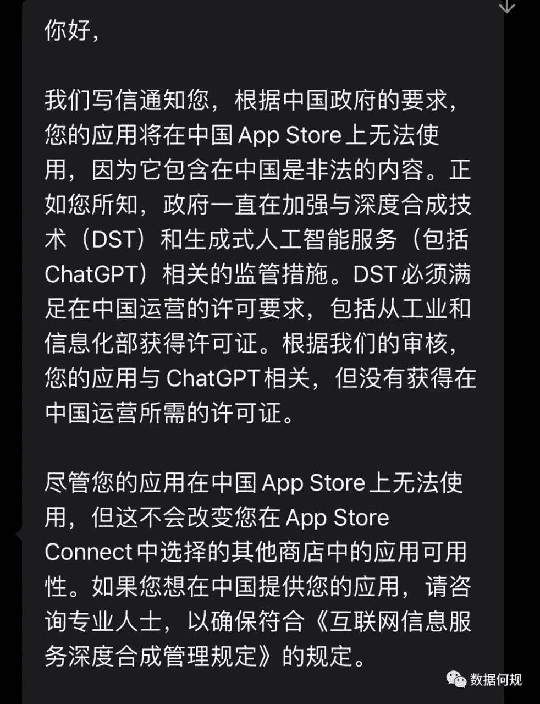
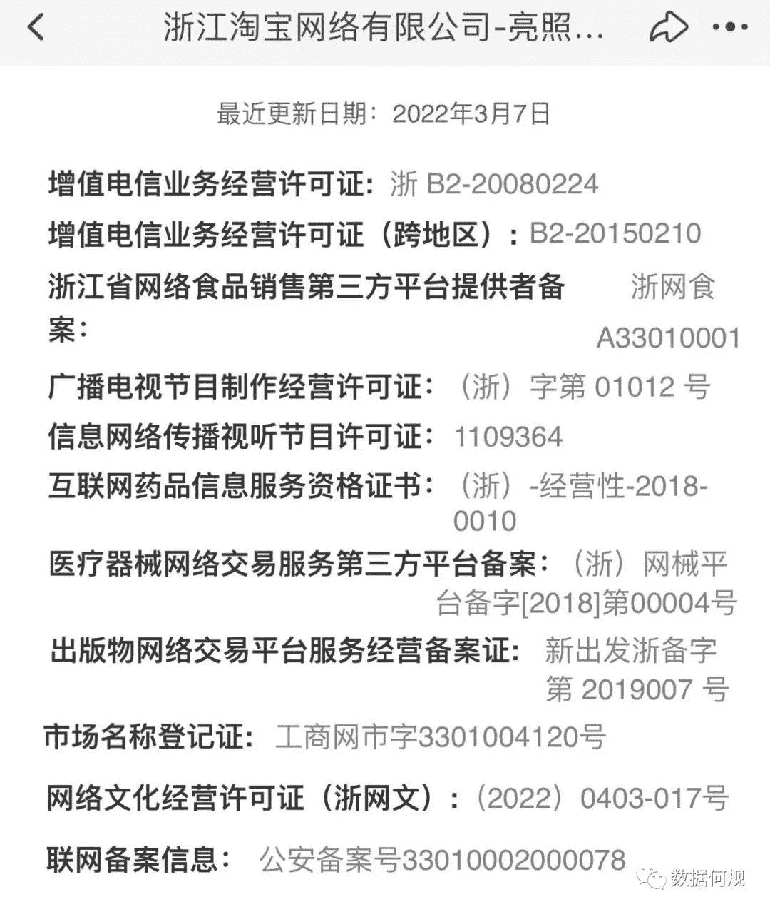
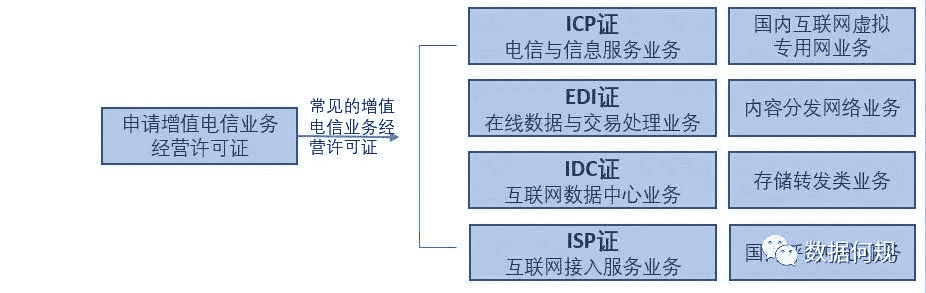

# 大模型上线需要哪些资质

> 来源：[https://docs.feishu.cn/docx/AqiUdZPhUoOBibx1cwfcFLr0npc](https://docs.feishu.cn/docx/AqiUdZPhUoOBibx1cwfcFLr0npc)

**-问：**App store中国大陆区的Chatgpt类软件都下架了。这里的工信部的许可证是什么呀？

**-答1：**就是通管局发的增值电信业务许可证。

**-答2：**这也不一定是增值电信业务呀，我是开发者肯定看得一头雾水。

**-答3：**中伦最新文章，监管回复ICP许可不用：跨越AIGC产品合规上市之路（二）：资质证照篇。虽然我觉得应该细细论述一下那几个资质证照和AIGC产品为啥不搭边儿。

**-答4：**就是通管局发的增值电信业务许可证。

**-答5：**这也不一定是增值电信业务呀，我是开发者肯定看得一头雾水。

**-答6：**备案和许可看的不是付不付费。

**-答7：**直接问通管局：AI类APP是否需要办理ICP？这个问题问的不负责，当然答也不会负责了。

**-答8：**无需xxx感觉监管一般不会说，一般会和你说，按照xxx办法执行。

**-答9：**情景回溯一下，我们电话咨询是这么说的：我们是一款AI类的App，主要是提供生成语音的服务，可以生成合成多种类型的声音。这种情况是否需要获取ICP证？

广东答复说：根据我们目前掌握的情况，AI类的App是不需要拿ICP证的。一般是电子商务类的，就是做第三方平台的需要拿ICP证。

上海说的是，如果你是涉及到AI的话，就是不需要办理ICO许可证的。什么情况下需要呢？一般就是互联网信息服务，或者说增值业务，比如淘宝、京东。

然后我们接着问了一下是否需要备案，基本是一致的，需要做。

**-答10：**App是网源的一类，浙江之前有要求在ICP增加。

**-答11：**APP走的不是信息服务：互联网信息服务，当然不需要ICP许可证，但是不代表不需要其他增值电信业务许可证。ICP许可仅仅是增值电信业务许可之第二类增值电信业务许可之信息服务的一种。信息服务类的增值电信业务许可分为两种，一种是增值电信业务许可（信息服务：互联网信息服务），就是俗称的ICP许可；一种是增值电信业务许可（信息服务：不含互联网信息服务），就是俗称的SP许可。也可能是在线数据处理。

**-答12：**APP也可以通过移动互联网提供信息服务，也算法规定义的互联网信息服务吧。如果是经营性的话，我理解不当然排除ICP证的。广东的这个口径值得商榷。

[牌照/资质](https://cbe8t1r4a5.feishu.cn/wiki/wikcnU29fliEy3Bopg6TKTFPLec)

[AIGC](https://cbe8t1r4a5.feishu.cn/wiki/wikcntdefWZIuNZgDEusD7jvRBf)