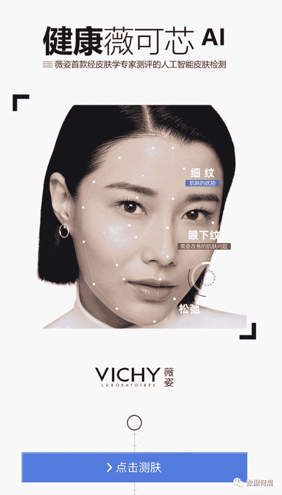
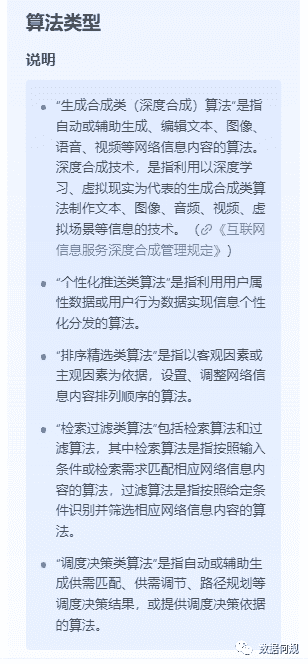

# AI皮肤检测合规

> 来源：[https://docs.feishu.cn/docx/C74kdeBVHo2AfHxOZVRcXgbYn2c](https://docs.feishu.cn/docx/C74kdeBVHo2AfHxOZVRcXgbYn2c)

**-问：**请教下大家两个问题，这种基于真实人脸数据，训练研发的皮肤状态检测工具，属不属于算法应用，需要做算法备案吗？另外这种所谓的辅助检测工具，需不需要什么医疗器械资质的备案？

**-答1：**关于医疗器械备案或批准应该是需要的。但如果仅仅是采集图像的分析，没有采集任何皮肤细胞用试剂进行分析，那么认定为医疗器械的概率是较低的。

**-答2：**我试用了一下这个产品，检测结果倒不是什么医疗诊断意见，就是类似你有黑眼圈，哪个地方是痤疮，细纹，暗沉啥的，然后下一步才是匹配所谓的皮肤顾问但也不是医生，就给出一些卖货建议了

**-答3：**这类产品一般没有训练这么高级的功能 就是检测你的皮肤一些指标。

**-答4：**我对比了一下法条，这种检测工具应该不属于个性化推送，排序精选和调度决策类的算法类型。有没有可能属于“检索过滤类”的算法，就是类似自动识别敏感词的算法一样，识别皮肤状态这种？或者能属于“生成合成类”算法吗？——通过分析有一些类似诊断结果的效果呈现。

**-答5：**基础的功能二年前就有不少公司做了 如果需要医疗器械资质 查一查现有产品就能看到。

**-答6：**我感觉很难算诶，我感觉这个可能就是一个基于深度学习算法的图像处理技术。

**-答7：**感觉更像是用户标签，和备案系统的说明贴不上。

**-答8：**但是下一步马上就会个推了 基于结果推荐医美方案或护肤产品。

**总结：不叫AI，估值很难上去。**

[AI](https://cbe8t1r4a5.feishu.cn/wiki/wikcntdefWZIuNZgDEusD7jvRBf)