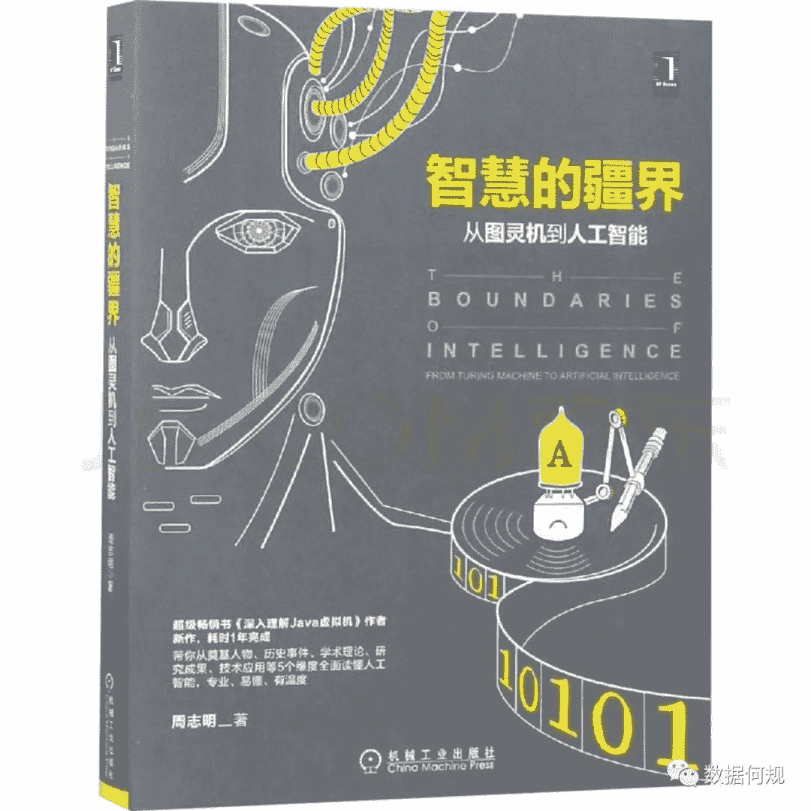
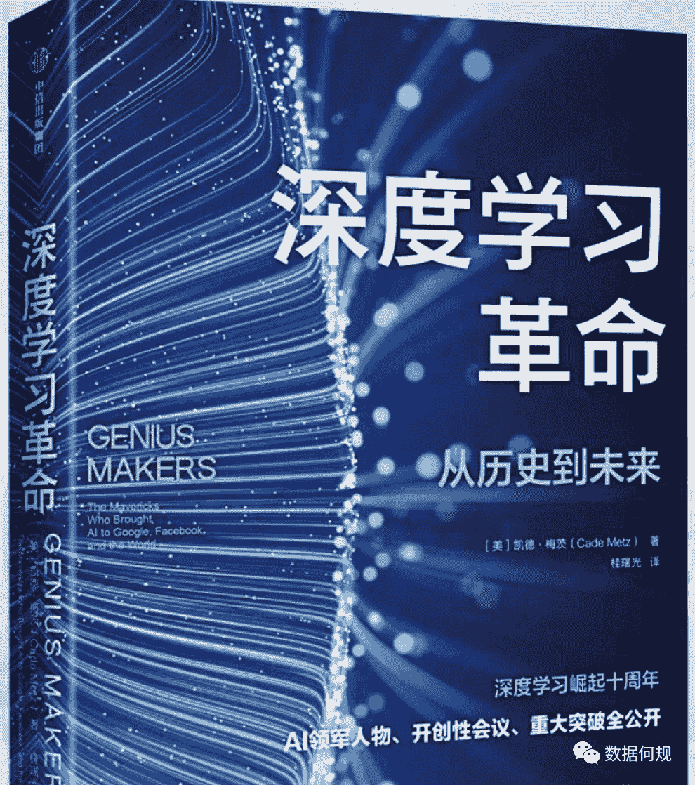
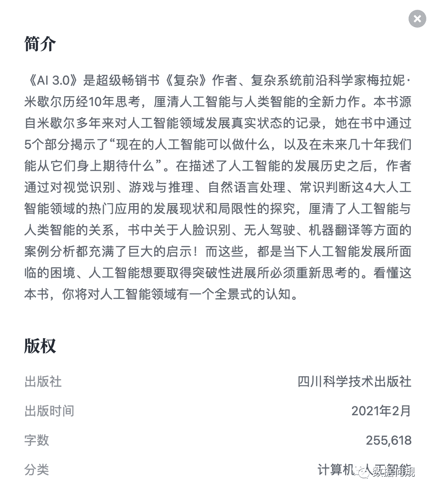

# AI发展书籍推荐

> 来源：[https://docs.feishu.cn/docx/NHq2dzSg8obZBMx04RTcknF3nUf](https://docs.feishu.cn/docx/NHq2dzSg8obZBMx04RTcknF3nUf)

**-问：**请问各位有没有人工智能发展史相关的书推荐？除了尼克的《人工智能简史》，希望内容尽量简洁明了。

**-答1：**最近在看这本，算是入门级吧。

**-答2：**这本还躺在待看书单里，书本推荐来自于  一档  播客：半拿铁，有个讲  人工智能的4集系列（相声）。

**-答3：**这本不错，推推。

**-答4：**关于AI入门，还推荐看Andrew Ng的慕课AI for everyone哈, Andrew Ng在机器学习领域很出名，我之前疫情宅家看了这个课程，觉得挺深入浅出的，这个课程的目标受众是没有技术基础的企业决策层，告诉他们AI是什么，AI的应用以及如企业部署AI部门需要考虑什么

[AI](https://cbe8t1r4a5.feishu.cn/wiki/wikcntdefWZIuNZgDEusD7jvRBf)

[隐私保护学习](https://cbe8t1r4a5.feishu.cn/wiki/wikcnUOBBCyCXpqoL31sHzxwj5d)