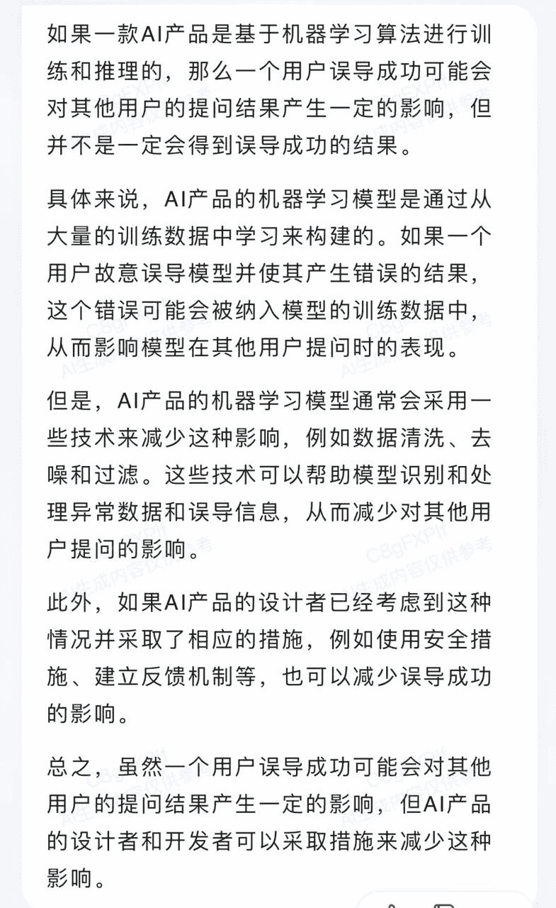
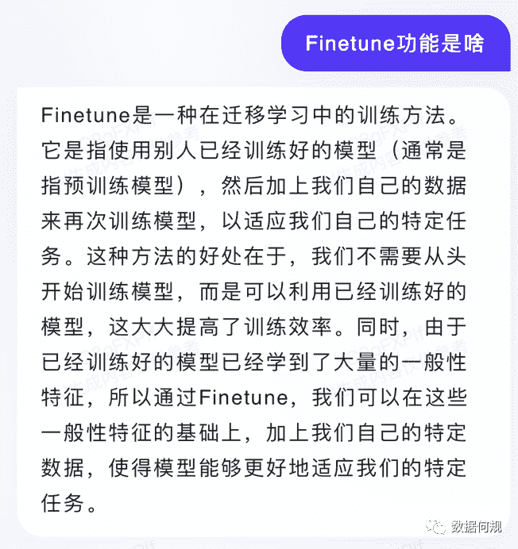
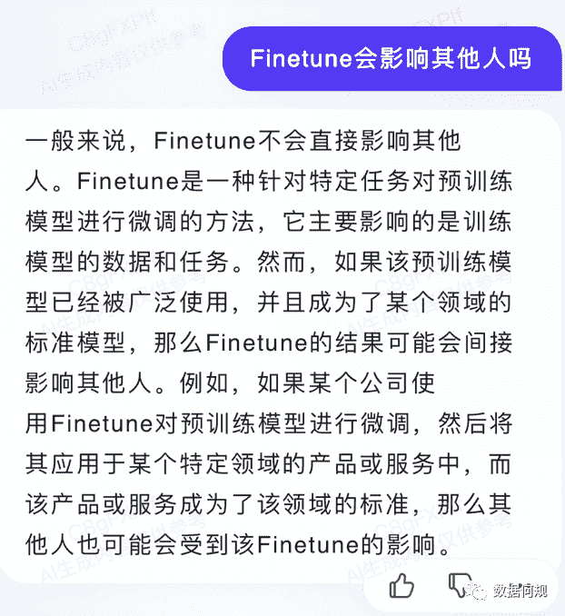

# AI算法被误导后会影响后人吗

> 来源：[https://docs.feishu.cn/docx/HjQOdG4wiovdj7x7CqbcJ6XNnDf](https://docs.feishu.cn/docx/HjQOdG4wiovdj7x7CqbcJ6XNnDf)

**-问：**想请教一下 同一款ai产品，如果一个用户误导成功了，其他用户提问的时候是否会得到一个误导成功的结果呀？

**-答1：**一次不至于的。

**-答2：**我觉得取决于这款大模型的数据库来源，如果很依赖用户问答且人工干预不到位，我理解是有这种可能?

**-答3：**你想问能不能自己finetune吧，并且**自己finetune的会不会影响别人吧。1.看是否开放f**inetune能力。2.你自己finetune的不影响别人，有些情况下是隔离的。

**-答4：**百度文心的回答。

**总结：还要考虑对话的连续性，个人理解**这种情况较难发生。文心一言本次表现不错。

[AI](https://cbe8t1r4a5.feishu.cn/wiki/wikcntdefWZIuNZgDEusD7jvRBf)

[算法/个性化推荐/自动化决策](https://cbe8t1r4a5.feishu.cn/wiki/wikcnXmiCb3VsyoTnYJ0RG3rerc)