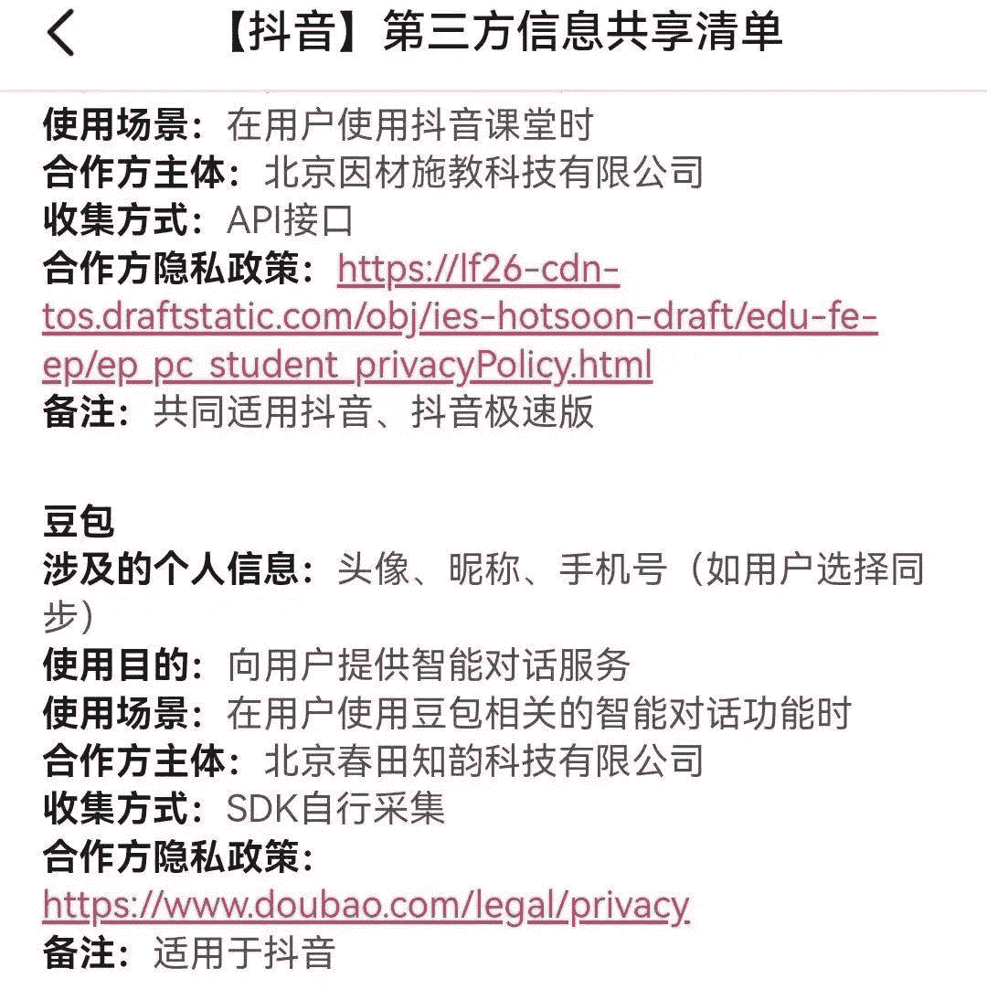

# APP接入大模型如何披露

> 来源：[https://docs.feishu.cn/docx/GxsTdEs78omO72xZofScIOuDnmc](https://docs.feishu.cn/docx/GxsTdEs78omO72xZofScIOuDnmc)

**-问：**如果产品接入了三方大模型，在前端隐私政策中需要做披露吗？如果要，颗粒度是怎么样的呀，有没有best practice参考呀，感谢！

**-答1：**有接入三方大模型，通过备案，面向客户提供服务的案例吗。

**-答2：**备案里的要求，标识，隐私政策。

**-答3：**最近两次上海WXB的培训上，有公司是接入三方大模型再做备案的，都是在备案中，还没有通过。

**-答4：**有些是作为**SDK**披露的。

总结：接入第三方大模型也要做备案，通过的先例较少。

[AI](https://cbe8t1r4a5.feishu.cn/wiki/wikcntdefWZIuNZgDEusD7jvRBf)