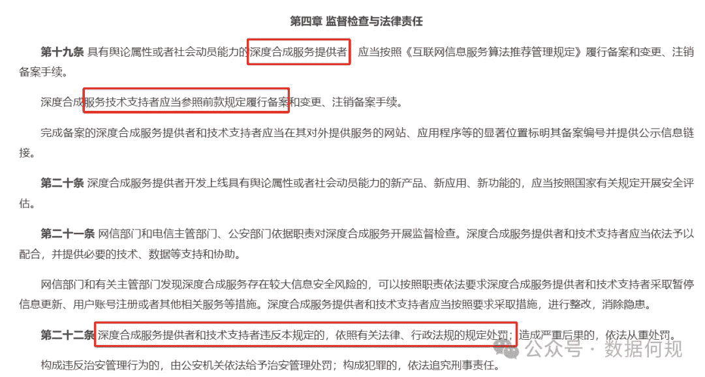
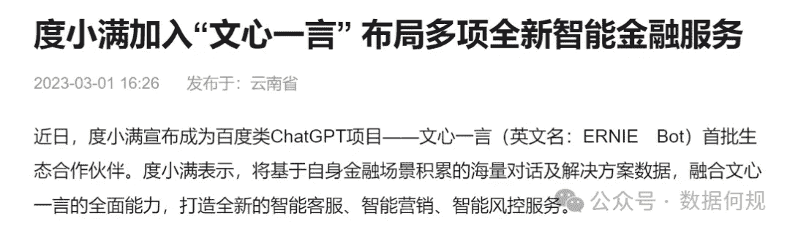
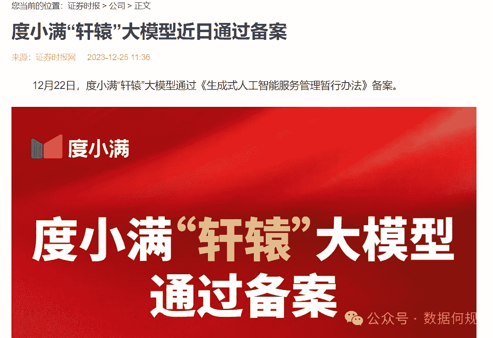

# 大模型备案讨论

> 来源：[https://docs.feishu.cn/docx/FOttdSJKOokEmXxzq9GcuzkEnRb](https://docs.feishu.cn/docx/FOttdSJKOokEmXxzq9GcuzkEnRb)

**-问：**A提供智能客服服务能力，给B端客户提供智能问答服务，A属于服务提供方还是技术支持方？服务提供方和技术支持方，区别到底是哪里？

**-答1：**都提供客服服务了，那肯定是**服务提供者**了。

**-答2：**这个gpt那会我们公司就要做，大家一致意见都是对B服务也算，然后是服务提供者。

**-追问：**目前没有chatgpt的算法备案成功案例吧？

**-答3：**应该不行吧，得有备案号。理论上通过三大运营商合法接入VPN的话，可以使用吧，但仅限内部使用，所以做不了备案。

**-答4：**是的，如果基础模式是没有备案的大模型，应该都过不了现在。

**-答5：**TC260的《生成式人工智能服务安全基本要求（征求意见稿）》堵死了使用境外大模型基座。

> a)提供者如使用基础模型进行研发，不应使用未经主管部门备案的基础模型。

> 6 模型安全要求

**-答6：**所以微软声称自己不用备案，但可以配合企业去做备案，根本是白搭…

**-追问**：继续请教一个关于aigc合规的问题：

1、 A公司研发一款面相企业的aigc工具（类似智能客服、数字人）卖给B公司，这个工具不面向用户，不在应用市场上架。B公司利用该工具为用户服务。这里面A是技术支持者，B是服务提供者吧。但是算法备案的义务主体应该是A公司吧？

2、 如果A公司的产品没有获得算法备案批号，B公司使用这个产品有什么具体的行政合规风险吗？我看《互联网信息服务深度合成管理规定》22条，写的比较笼统，目前也没有检索到公开的处罚案例（因为没有拿算法备案，A或者B公司被处罚的）。

**-答6：**技术支持者和服务提供者都需要算法备案的。两个备案内容不一样的，侧重不同。文心一言是两个身份的备案都做了，因为他又To B又To C。

**深度合成服务提供者，一般理解为直接面向C端用户提供产**品的主体，直接提供APP、网页、小程序。

**深度合成服务技术支持者，一般理解为面向B端用户的企业，通**常通过API、SDK的方式提供技术支持。

**填**报时，技术支持者在算法策略、算法风险和防范机制方面，填写的内容更为简单，一般这部分内容会严格要求服务提供者填写。

**-答7：**这种相当于【B2B2C】模式，B公司利用A的软件工具，向用户提供服务。比如度小满接入百度的文心一言，文心一言本身已经过了算法备案，度小满也要再做一个备案？

**-答8：**要的，度小满本身是作为to c的服务提供者，而且一般接入的是通用大模型，关键词库也都不是完全一样的。

**-答9：**跟百度和字节我都对接过，**都建议我备案**。

**-答10：**这个场景还能理解，问题是一些不那么高科技的产品，就是一个智能客服，数字主播。B企业使用A的工具，也要备案是不能理解。

**-答11：**看是不是集成技术，如果直接是使用**方，造完了形象就自己用，你就是**使用者呀，集成后对客提供AIGC能力才要，我企业捏个脸，弄个虚拟主播，去口播新闻，这种肯定不需要备案，企业自己是AIGC能力使用方，和个人客户使用没区别。

**-答12：**同意。界面端做标识一下。

**总结：反过来想想立法目的，国家为什么要求备案？很多答案就简单了。还有，需要备案的算法有很多种，AIGC只是其中一种？从内容管理的**角度，AIGC的风险是最大的。分分钟搞个特朗普出来宣布战争。绘画风险也大，PS个名人艳照，风险也很大。所以，这块儿的监管，肯定会严格的。总而言之，问就是要备案。

[AI](https://cbe8t1r4a5.feishu.cn/wiki/wikcntdefWZIuNZgDEusD7jvRBf)