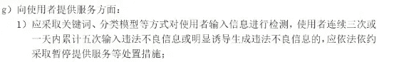

# 大模型内容安全

> 来源：[https://docs.feishu.cn/docx/W6ondvMi5oKv1yxXhLOcuNNYnFf](https://docs.feishu.cn/docx/W6ondvMi5oKv1yxXhLOcuNNYnFf)

**-问：**很想知道目前比较好的解决方案是什么，感觉国内有些大模型屏蔽提示这块的表现，拒答率有点子高。

> 免注册版 ChatGPT 引入了更多内容保障措施，例如在更广泛的类别中屏蔽提示和生成。

> 公众号：APPSO

> 凌晨重磅！ChatGPT今天起无需注册就能用

**-答1：****内容风控**不是法律侧的事情。我理解可以有几个方向，第一，对风险问题进行同**义替换而不是拒答，比如**用户问西藏是不是中国一部分，替换为更广义的，对领土完整怎么看。第二，解决提出问题的人，多次触发风控线直接封号。

**-答2：**有**非拒答库**的，正向引导。

**-答3：**是不是**直接封号成本更低**呀。

**-答4：**预算充足的话直接采购**人民网舆情管理**的内容合规产品吧。

**-答5：**我用敏感问题测试了五次国内某大模型给我封号了。落实了《安全基本要求》的规定。

**-答6：**数据合规与**内容合规**，一个是铠甲一个是盾牌，双剑合璧。

**-答7：**数据合规的有些灰色地带可以商讨take 不take risk，内容合规应该是无商讨的余地吧。

**总结：内容安全不好做。**

[AI/大模型](https://cbe8t1r4a5.feishu.cn/wiki/wikcntdefWZIuNZgDEusD7jvRBf)