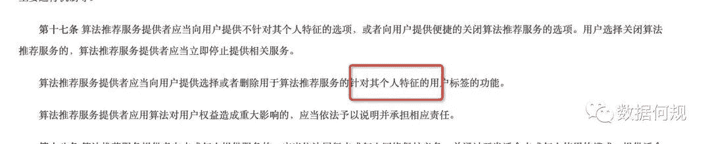
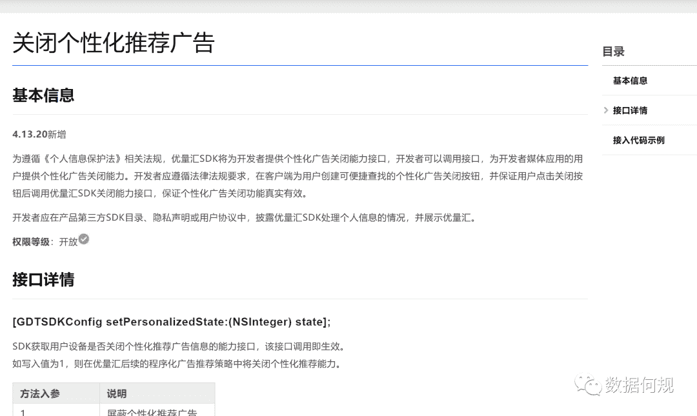

# 用户标签合规

> 来源：[https://docs.feishu.cn/docx/FjmTdt65NoOzoQxVbihcnawIn4B](https://docs.feishu.cn/docx/FjmTdt65NoOzoQxVbihcnawIn4B)

**-问**：对应商户，用户的标签和画像，有什么数据合规方面要注意的点么？

**-答1：**《算法规定》有要求。

**-答2：**这里是算法推荐场景下的数据处理，还是要结合业务需求考虑标签和画像的场**景和用途。比如金融风控类的用户**画像，如果是2B端，其实是不用考虑这个推荐场景的，只需要考虑自动化决策的合规要求。

**-答3：**不折现，对装备你只拥有使用权。

**-答4：**《上海市网络交易平台网络营销活动算法应用指引（试行）》

第八条（**消费者画像**）

网络交易平台经营者利用消费者个人信息进行用户画像时，应当符合《个人信息保护法》《消费者权益保护法》等法律法规的规定，确保消费者画像依据来源合法，尊重消费者人格尊严，避免使用有违社会公德、歧视性、偏见性用户标签，发现消费者画像存在错误的，有必要及时进行修改。

网络交易平台经营者使用含有下列内容的用户标签对消费者进行画像，可能会侵犯消费者的人格尊严，影响消费者画像的公正、客观性：

（一）使用含有淫秽、色情、赌博、迷信、恐怖、暴力的内容；

（二）使用含有表达对民族、种族、宗教、残疾、疾病、性别歧视的内容；

（三）使用含有其他有违公序良俗的歧视性、侮辱性文字的内容。

**-答5：**应用市场最近在抓个性化推荐，有的会要求在隐私政策做很详细的说明。颗粒度细到比如会要求说明关闭个性化推荐或者用户画像推送是否要用户在登陆状态下才能关闭，总的感觉就是网信办算法规定出来以后各方面有点小动作。

**-答6：**可参考下图。

**-答7：****主要以下几点，****1）所有个性化推荐的功**能模块都在要隐私政策上说明。2）功能模块的标题，副标题，最好能突出个性化推荐控制的状态。比如本栏目由个性化推荐服务提供。3）监管现在看到App上面页面看到推荐2个字就怀疑是推荐功能。所以如果不是个性化推荐，就不要取名叫xx推荐，会误导。

**-答8：**一方面是人工检测的时候**关掉推荐，自行观察**，几台设备对比一起看；另一方面我理解主要靠企业自证，提供开/关推荐功能时，对当前算法的描述？曾经为一家客户做过关闭推荐功能的验证，几个用户都关掉了，然后看下大家首页商品展示是不是一样的。

**-答9：**很多UGC信息流平台现在都有叉掉不喜欢的按钮了，好奇这种直接叉掉不喜欢-选择标签-确认的模式是不是也算个性化推荐的一种。比如知乎跟b站。

[算法/个性化推荐/自动化决策](https://cbe8t1r4a5.feishu.cn/wiki/wikcnXmiCb3VsyoTnYJ0RG3rerc)

[个人信息定义](https://cbe8t1r4a5.feishu.cn/wiki/wikcnwGGoWGzMNhr26Z4UO55xVF)