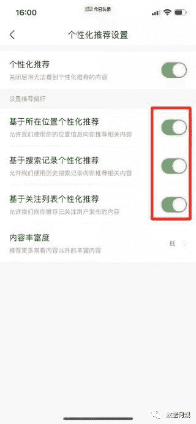
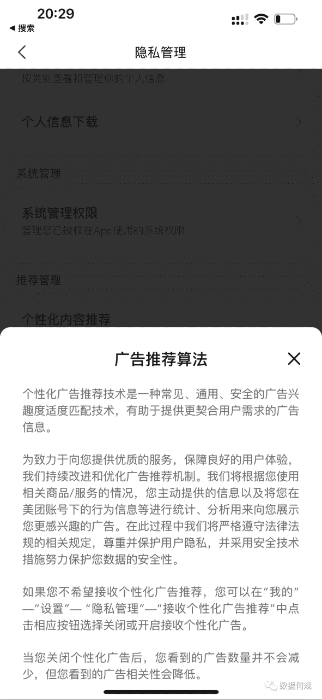
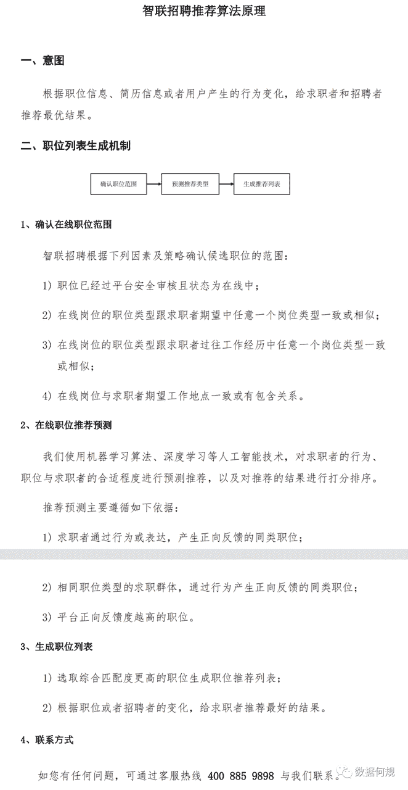
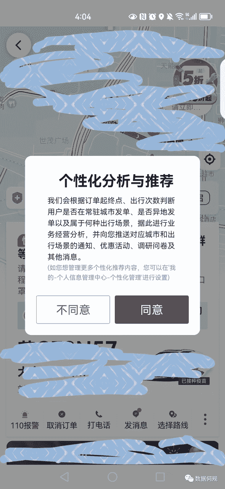
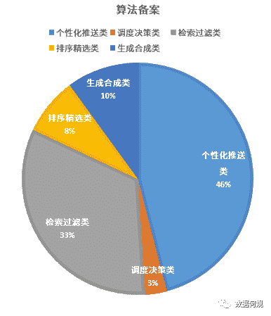

# 个性化推荐的告知

> 来源：[https://docs.feishu.cn/docx/QtrjdIBuToKhTQxMxaDc9YitnHe](https://docs.feishu.cn/docx/QtrjdIBuToKhTQxMxaDc9YitnHe)

**-问：**抛个话题，大家觉得个性化推荐的知情同意该咋做？我们合规说，因为个性化推荐集合了交易记录，个人信息(喜好)，定位等信息，所以弹框一揽子知情告知不合要求，需分开告知。

**-答1：**隐私政策+算法原理公示专门页面+个性化推荐开关 其他待大佬补充

**-答2：**看看这篇：GB/T 35273中“个性化展示使用”相关条款测试技术解析。

**-答3：**如果要做成这样成本就比较高了。

**-追问：**个性化推荐的算法公示哪里可以抄作业？

**-答4：**美团 抖音 一点资讯 还有通过备案的那些都可看。这是美团的。

**-答5：**算法备案平台也可以看。这是智联招聘的。

**-答6：**个性化推荐进行单独opt in同意模式的例子，新鲜上架的滴滴。

-答7：算法备案平台可以抄的作业不少。

**-答8：**看到**这个**想起来这两天回家，🛰️广告也自动变成老家这边门店的广告了，但我明明把个性化广告开关关闭了，也没有连接家中的wifi。查了🛰️隐私政策里调用地理位置权限并没有提到用于广告，体感就很差（当然🛰️并不在意就是）。我对个性化推荐这个没有意见因为虽然基于地理位置给我推了门店，但是内容我并不感兴趣，确实遵守了我个性化开关的设置。主要是这个地理位置，我系统里没有给🛰️地理位置权限，🛰️如果调用，每次都需要我同意。但我记得我最近并没有再授权过，所以对于🛰️了解到我的位置发生变更还是有点介意。不通过gps，通过LBS这种不需要获得授权吗？

**-答9：**Ip地址也行吧。

**-答10：**看了一下后台权限，有发现并链接到附近的蓝牙、WLAN设备的权限。网络访问 数据传输 与基站等进行交换过程 有部分数据包中的相应数据 能够在一定程度上 实现 大概的“位置”而该等位置因为，不属于个人信息，所以进行相应的使用（用于产品本身，或所述的“内容推荐”——注意区分并不是个性化推荐，只是一般的“广告”），也并不违反服务协议或隐私政策，而且因为其属性/特征无法被认定为个人信息，则也不会被认定为要求取得“授权”。要求取得“授权”基于相应的法律法规及/或监管政策等，但是如果本身并不属于规范的内容，则无限制，无限制即自由。用最简单的语言概括就是，我认为，是产品服务协议对诸如合理使用、广告展示等进行了约定，然后通过一些不违规的技术手段取得了不属于个人信息的在产品运行过程中产生的数据，并使用该等数据进行了广告展示。

[算法/个性化推荐/自动化决策](https://cbe8t1r4a5.feishu.cn/wiki/wikcnXmiCb3VsyoTnYJ0RG3rerc)

[告知](https://cbe8t1r4a5.feishu.cn/wiki/MBURwAcGAikdAmkoOqJcwnmKnPh)