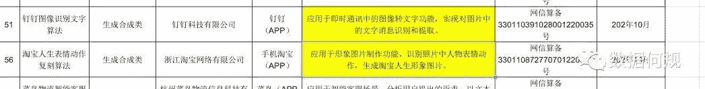

# 舆论属性和社会动员能力的认定

> 来源：[https://docs.feishu.cn/docx/DcUIdKmTVoXhssxUf12caGJUnOd](https://docs.feishu.cn/docx/DcUIdKmTVoXhssxUf12caGJUnOd)

**-问：**想请教一下，关于“具有舆论属性或者社会动员能力的算法推荐服务提供者应当通过互联网信息服务算法备案系统填报信息，履行备案手续。”这里的舆论属性或社会动员能力怎么理解的呀？《具有舆论属性或社会动员能力的互联网信息服务安全评估规定》中举的例子是“（一）开办论坛、博客、微博客、聊天室、通讯群组、公众账号、短视频、网络直播、信息分享、小程序等信息服务或者附设相应功能；（二）开办提供公众舆论表达渠道或者具有发动社会公众从事特定活动能力的其他互联网信息服务。”

但是查看互联网信息服务算法备案系统公示的一些算法。这些的舆论属性或者社会动员能力是怎么体现的呢？

**-答1：**这里限定的是**算法服务提供者的特性**，而不是算法的特性吧。钉钉、淘宝肯定有信息分享功能啊。

**-答2：**一个算法是否具备舆论属性，在前期不一定能够发现的，技术中立原则嘛。但一个服务提供者所提供的服务主体是否具备舆论属性，我觉得是相对好判断的，要求他们将所涉及的算法全部报备，也更为合理些。

**-答3：**前几天就这个问题跟网安负责备案的老师沟通过，按照北京这边市局给的内部工作指引，认定舆论属性主要看产品或服务的功能属性，只要具备了沟通交互属性的产品功能，一般都会被认定舆论属性，需要在备案表里列上，和产品的实现形式、生成内容没有必然联系。

**总结：**在平台维度，不是算法维度，应有之义。

[算法/个性化推荐/自动化决策](https://cbe8t1r4a5.feishu.cn/wiki/wikcnXmiCb3VsyoTnYJ0RG3rerc)