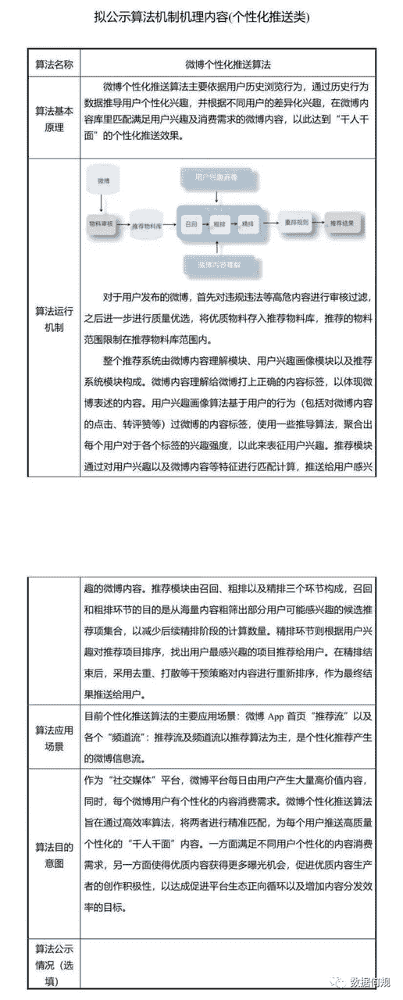

# 算法推荐公示

> 来源：[https://docs.feishu.cn/docx/RCEtd25VsokuXLxpjeqcYSpMnhd](https://docs.feishu.cn/docx/RCEtd25VsokuXLxpjeqcYSpMnhd)

**-问：**算法推荐的公示，有什么企业的做法可以参考一下吗？

> 算法推荐服务提供者应当以显著方式告知用户其提供算法推荐服务的情况，并以适当方式公示算法推荐服务的基本原理、目的意图和主要运行机制等。

> 《互联网信息服务算法推荐管理规定》第十六条

**-答1：****美团、🧣、智联招聘、豆瓣**都有发过的，详见：[算法公示如何抄作业](https://cbe8t1r4a5.feishu.cn/wiki/wikcn4JFpgPregqKKvUuNw2oXRp)

**-答2：**互联网信息服务算法备案系统已经备案通过的公示都有，https://beian.cac.gov.cn/#/searchResult。

**总结：作业很多可以抄。**

[算法/个性化推荐/自动化决策](https://cbe8t1r4a5.feishu.cn/wiki/wikcnXmiCb3VsyoTnYJ0RG3rerc)