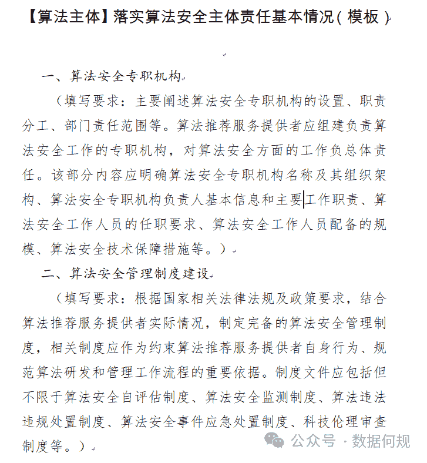

# 认定“舆论属性或者社会动员能力”

> 来源：[https://docs.feishu.cn/docx/WqVBdfM3coYhDmxhxP6cAedMnwb](https://docs.feishu.cn/docx/WqVBdfM3coYhDmxhxP6cAedMnwb)

**-问：**公司产品想要接入大模型在做算法备案。我发现即使是接入大厂大模型提供服务，都会要求必须有专门的算法安全专职机构和制度。

我在想，这么要求的话，很多小企业的合规成本真的挺大的，感觉不利于AI技术的普及呀。我同步也在做海外产品接入大模型的合规，感觉海外要求就宽松些。

**-答1：**这个专职他怎么定义呢？我临时抓一个做安全的人，说他是算法安全岗。好像他也查不出来？

**-答2：**有就行，反正到时候别抓不出来。

**-答3：****任命书**吧。

**-答4：**保险点得在公司有发文来**证明职位、职级、职责**吧。

**-答5：**对呀，这小企业咋搞哟。可能一个公司就几十号人。搞一个专职机构，还要专门制度。

**-答6：**延展一下，关于AI产业的合规问题，我之前听到两家通过备**案的**大模型企业的对立观点，觉得很有意思。一家企业说，希望有更多的企业通过大模型备案，这样监管就不用死盯着这三十家，他们的合规压力也小一点；另一家说，这就是对大厂利好，因为大厂能够承担这样的合规成本，所以他们有先发优势。

**-答7：**监管角度肯定不希望人人大模型啊，抓大放小，既不限制行业发展，又控制数量咯。变相牌照制。

总结：小机构只能虚设委员会、机构了。

[算法/个性化推荐/自动化决策](https://cbe8t1r4a5.feishu.cn/wiki/wikcnXmiCb3VsyoTnYJ0RG3rerc)