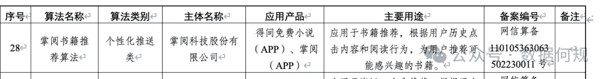

# 算法备案的维度

> 来源：[https://docs.feishu.cn/docx/GaC6dkuIxogDC1xB2nNcOYXznc3](https://docs.feishu.cn/docx/GaC6dkuIxogDC1xB2nNcOYXznc3)

**-问：**请教下各位大佬：算法备案是按照产品来的还是算法来的？例如，我有一个个性化推荐算法应用于A、B产品，备案是A和B分开备案的？；还是A、B统合起来，备案一个个性化推荐算法就可以了？

**-答1：**后者，可以看看公示表，蛮多是一个算法在多平台的。

**-答2：**除非包装成不同的故事，文生文，图生图。

**-答3：**那个性化广告算法和个性化推荐算法并没有严格区分或者说要求分别备案吧？因为我看豆瓣的广告和内容是分开备案的，感到好奇。

**-答4：**官方的推荐算法分类里面也没有也没有个性化广告这个类目啊。豆瓣分开备案是因为算法不一样呀。

**-答5：**广告是推荐的子项吧 广告是广告法定义的。

总结：还是基于算法维度来备案的，一种算法一个备案。

[算法/个性化推荐/自动化决策](https://cbe8t1r4a5.feishu.cn/wiki/wikcnXmiCb3VsyoTnYJ0RG3rerc)