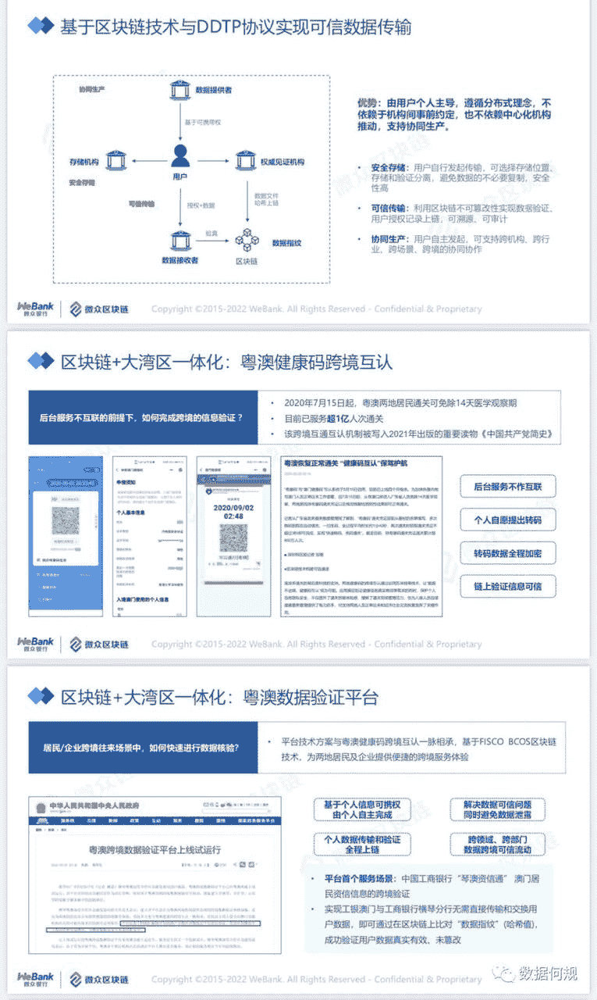

# 个人信息可携带权案例

> 来源：[https://docs.feishu.cn/docx/LjVydzPZpopxROxLTMecD2bPn5d](https://docs.feishu.cn/docx/LjVydzPZpopxROxLTMecD2bPn5d)

**-问：**现在个保法下的可携权，跨法人主体的，有实践成功的案例吗？

**-答1：**手机号**携号转网**，云服务好像也有类似要求，其他的实现的不多。

**-答2**：这个微众银行的ppt也提供了一些案例：https://theasianbanker.com/finance-china2022/pdf/present-slides/Hata-Fan.pdf。

**-答3**：平台**首个服务**场景：中国工商银行“琴澳资信通” 澳门居民资信信息的跨境验证• 实现工银澳门与工商银行横琴分行无需直接传输和交换用户数据，即可通过在区块链上比对“数据指纹”(哈希值)，成功验证用户数据真实有效、未篡改。这个算是可携权吗，我咋感觉这是大集团下的数据融合，同时涉及了数据跨境。

**-答4：**感觉是数据共享不是可携，我今天不想用工商银行了，你把我们流水，银行卡号给建设银行。

**-答5：**是，可携权，理论很美好，实践做不来。

**-答6：**要有**公有的协议**、标准，才能做。比如你要把日历日程导出来，那就ics;要导联系人，就vcard;要导gps轨迹，就gpx…不然大家都是非标的，你做的可携带最多也就是能看看，用不了。

**总结**：GDPR下的可携带权的落实也存在类似的问题，没有统一的标准，反而导致数据只可以在大平台间携带。

[个人信息主体权利](https://cbe8t1r4a5.feishu.cn/wiki/NlHiwgnN3igX5okLEfwc5Osmnab)