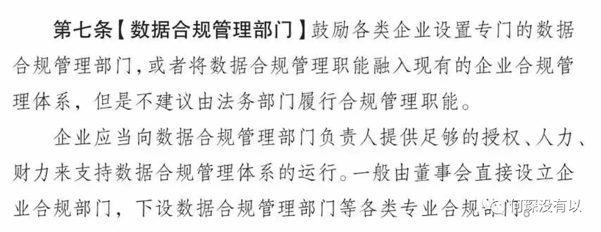

# 数据合规牵头部门

> 来源：[https://docs.feishu.cn/docx/S0UodY9uVowKSMxZKDBc9lXgniG](https://docs.feishu.cn/docx/S0UodY9uVowKSMxZKDBc9lXgniG)

**问：**刚刚听讲座，一位前辈介绍在上海50%以上的DPO设在法务部，大家怎么看？

**-答1：**我觉得应该在安全部门。

**-答2：**DPO这个角色，如果公司没有专门的数据合规部门，那么法律合规或者技术团队数据管理部门会比较适合。

**-答3：**安全部门也行，就是要看安全部门的地位。

**-答4：**上海不是明确说了不建议由法务部门履行合规管理职能吗，不过那个只是杨浦区检察院的建议。

**-答5：**我们借着杨浦检察院的那个指引，试图把DPO的事情推出去了，但法务部会配合法规政策解读工作。

**-答6：**放哪决定成本出在哪，出了问题谁主责，所以在这个阶段 IT也好安全也好包括法务，都不希望成为主要负责部门，除非真的有专门的部门了，有这个部门的也都是非常重视且愿意划预算的。

[数据合规组织架构](https://cbe8t1r4a5.feishu.cn/wiki/wikcnlxF9xO2z6An0Ox0bzZRtqI)