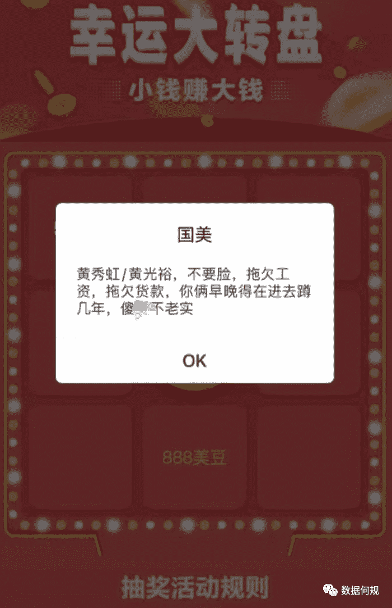

# 国美事件定性及处置

> 来源：[https://docs.feishu.cn/docx/HlRXdR5aNogwzRxVXgXc6yeOnni](https://docs.feishu.cn/docx/HlRXdR5aNogwzRxVXgXc6yeOnni)

**-问：**国美这个事情，知名品牌突发！APP弹窗辱骂创始人，算是信息安全事件吗？这种事内部调查主导是哪个部门呢，是信息安全去主导调查，还是人事部门，还是廉洁部门？

**-答1：**技术止损，安全调查，HR开人。

**-答2：****安全先排查问题**的原因，再分情况讨论。

**-答3：**我持其他看法。这种应该**法律合规、内控或者稽核调查**的。安全能查啥。把安全神话了。

**-答4：**这种应该什么**职业道德检查**吧，安全搞不了。

**-答5：**算上线过程中change management，没做好。

**-答6：**可能是负责**内部监察、内控的**部门主导。

**-答7：****安全能溯源**。

**-答8：**谁负责启动调查跟企业内部职权划分有关吧？不过一般信息安全事件不会是HR启动。

**-答9：**如果是你把人家页面黑了篡改的呢？

**总结：踢皮球吧。**

[数据合规组织架构](https://cbe8t1r4a5.feishu.cn/wiki/wikcnlxF9xO2z6An0Ox0bzZRtqI)