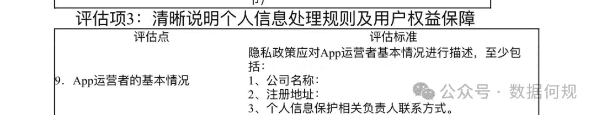

# 个人信息保护联系方式

> 来源：[https://docs.feishu.cn/docx/XiD3dO5bRovjlgx6Cb1ciL6Snrb](https://docs.feishu.cn/docx/XiD3dO5bRovjlgx6Cb1ciL6Snrb)

**-问：**有没哪要求隐私政策必须写明个人信息负责人联系方式的？

**-答1：**不用非得一定是负责人，**有个联系方式就行**。

**-答2：**以前要人，后面改了。

**-答3：**个保法要求公示个保负责人联系方式，但不一定要在隐私政策。官网和隐私政策都有，一般就留个邮箱。

**-答4：**汽车行业有公布联系人姓名的要求，但未必是隐私政策。

**-答5：**个保法17条，《App违法违规收集使用个人信息自评估指南》评估项3。

**-答6：**负责人是指一号位吗，还是只要管这事情的人就好。

**-答7：**反正不要名字，一个邮箱就好。

**-答8：**监管会问你怎么不留电话。

**-答9：**过渡期，正在调整，回头补。

**-答10：**留个座机就成

**-答11：**感觉现在写邮箱的多，或者400，邮箱可以一个部门一起用。

总结：留个联系方式就好，邮箱或座机，有人响应就好。

[数据合规组织架构](https://cbe8t1r4a5.feishu.cn/wiki/wikcnlxF9xO2z6An0Ox0bzZRtqI)