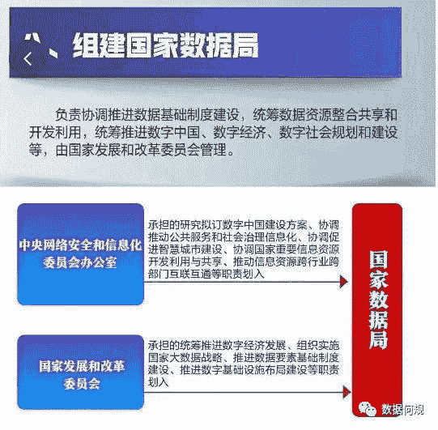

# 怎么看待组建国家数据局

> 来源：[https://docs.feishu.cn/docx/VHOtdKraeoqpkQxP5V2cdNsIn7d](https://docs.feishu.cn/docx/VHOtdKraeoqpkQxP5V2cdNsIn7d)

**-问：**如何看待数据局成立？

**-答1：**这个数据局好像没啥监管职能。

**-答2：**看看后续的怎么规划，这个大动作调整，能否落地还是个迷。

**-答3：**九龙治水→十龙治水。

**-答4：**数据局那边应该是国家调控数据经济 ，特别是数据交易那部分。

**-答5：**数据局是多一个促进数据发展部门，应该不会构成新的监管。

**-答6：**网信办划入的职能只有规则创立和协调的部分，与发改委对应的部门组成的团队，应当也会以规则制定、试验、统计、分析、持续优化为主，执行和落地的内容应该鲜有涉及，更多的领导/指导地方完成数据要素产业化建设/转型/创新/风险防范。

我感觉网信办像是“守门人”，把好关乎国家安全、人民安全的数据和信息之门，本国籍和外籍的“坏人”都不会放过。

工信部像是“守护者”，在阳光下天天看“你们还有哪里可以做得更好的地方，都给我改！

未来数据局可能会是“教育者”，制定规则普及规则执行规则，引导建立良性数据市场形态。然后还有一些极度专业的部门，就是在他们专业范畴同时扮演三个角色了。

总结：数据局的主要职能是促进数据流动，监管执法权仍在网信办等机构手中。

[监管机构](https://cbe8t1r4a5.feishu.cn/wiki/wikcnqYiqosgT4prvuNjTaCgGgc)