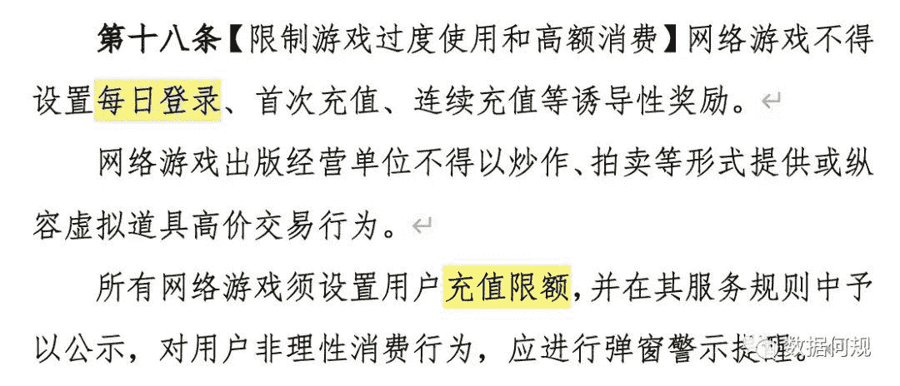

# 游戏行业主管部门

> 来源：[https://docs.feishu.cn/docx/L8dLd4gOEohKOKxYzBKceQuQnkd](https://docs.feishu.cn/docx/L8dLd4gOEohKOKxYzBKceQuQnkd)

**-问：**《网络游戏管理办法》(草案征求意见稿)是哪个部门负责立法呀？

**-答1：**出版主管部门，即国家新闻出版署。

**-答2：**以前是文旅管，后来文旅说我管不好游戏，还是交给版署管吧。

**-答3：**分清中宣，文旅，新闻出版，广电的职能和部委改革，是判断游戏律师位阶水平的副本。

**-答4：**广电：网络游戏出版方需取得《网络出版服务许可证》。

**中宣（新闻出版署）：19年后监管新闻+网络游戏。游**戏发行前需取得网络游戏出版物号（版号）。

**文旅：19年后不再监管网络游戏，网络游戏无**需再申请《网络文化经营许可证》（文网文）

工信：网络游戏运营方需取得ICP证。

**-答5：**以前2个部门为了魔兽世界，分别为九城和网易站台，打对台戏。。

[监管机构](https://cbe8t1r4a5.feishu.cn/wiki/wikcnqYiqosgT4prvuNjTaCgGgc)