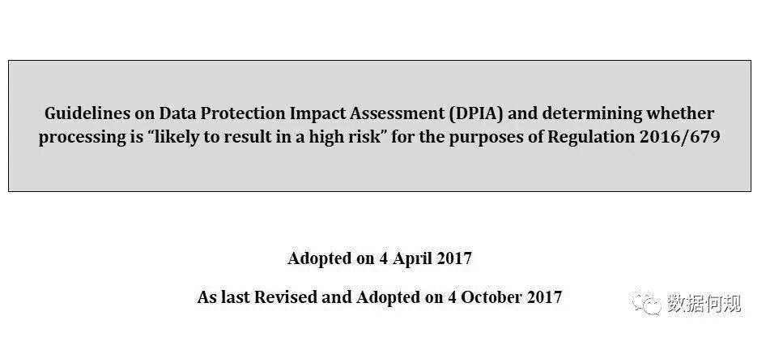

# EDPB对DPIA的指南

> 来源：[https://docs.feishu.cn/docx/TmzudqL7AofqNhxiJqQccEJcnOb](https://docs.feishu.cn/docx/TmzudqL7AofqNhxiJqQccEJcnOb)

**-问**：请问EDPB有没有就DPIA出指南呀？

**-答1：**有一个这个不一定是最新的。

**-答2：**EDPS在2017晚一点出了一个，我理解方向上和WP29没啥太大区别～继续深究还可以分别看看法国爱尔兰等国DPA出的指南。

**-答3**：可以看看这个，W29：欧盟数据保护影响评估（DPIA）何时做？怎么做？

[个人信息保护影响评估/PIA](https://cbe8t1r4a5.feishu.cn/wiki/wikcnHEa0DAUanS9PP1dJIANUnf)

[欧盟](https://cbe8t1r4a5.feishu.cn/wiki/wikcn3Z7BUSRoMENb8QUxgwNJOf)