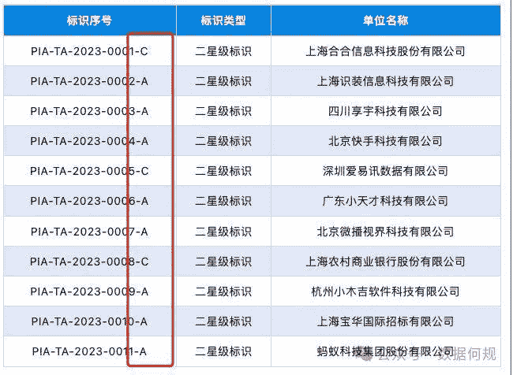

# PIA认证难度

> 来源：[https://docs.feishu.cn/docx/XTQ1dOQdgoKkWnxPeMIcO2sfnoI](https://docs.feishu.cn/docx/XTQ1dOQdgoKkWnxPeMIcO2sfnoI)

**-问：**请教一下个人信息保护影响评估PIA申报通知，做过pia认证的，哪个会相对容易一些？

**-答1：**一星随意做，二星的哪个场景都不少 内容都好细，A处理敏感 B是自动化决策吧 C是对外提供吧。

**-答2：****一星也不**是随便做，要审的，敏感个人信息会相对容易一点。按场景来的。-答3：三星得是二星里面的拔尖选手，三星一般企业做不了，得大平台。

**总结：本质就是一个花钱认证。**

[个人信息保护影响评估/PIA](https://cbe8t1r4a5.feishu.cn/wiki/wikcnHEa0DAUanS9PP1dJIANUnf)