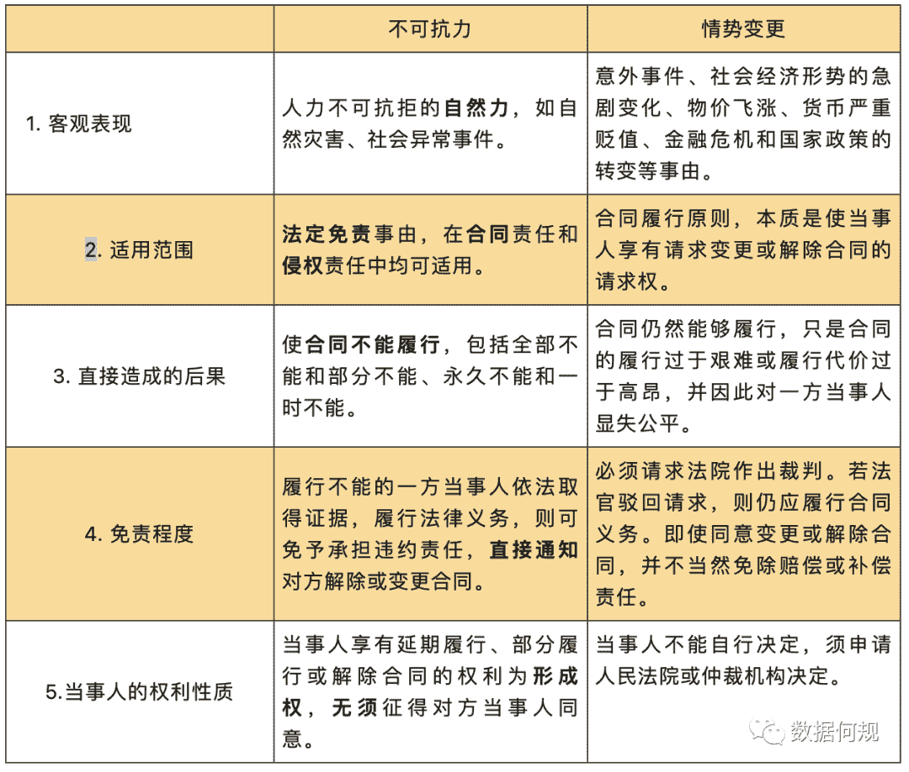
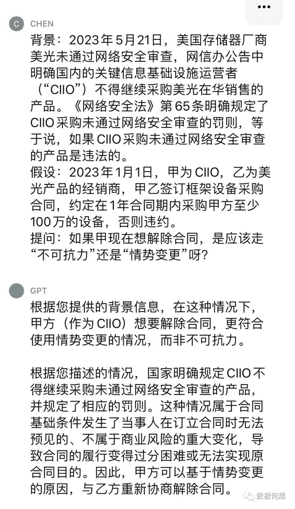

# 未通过网络安全审查是不可抗力还是情势变更

> 来源：[https://docs.feishu.cn/docx/T1mvdylwyoVscHxoqbucxRmAnof](https://docs.feishu.cn/docx/T1mvdylwyoVscHxoqbucxRmAnof)

**-问：**如果与供应商订立了一个长期采购合同，约定每一年度必需采购到某一金额，否则违约，而采购的产品均为美光品牌的，此时，甲方若确为CIIO，可以要求乙方更换美光，否则就解除合同吗？

**-答1：**首先，**合同**中**是否有针对CIIO采**购适销性的专属条款，如有，违约，看相应法律后果；其次，如果合同没有约定，未通过网络安全审查，法律性质算什么，是情势变更还是不可抗力，再看有什么请求权基础。

**-答2：**官方可是有提示过的。

> 问：何时申报网络安全审查？答：通常情况下，关键信息基础设施运营者应当在与产品和服务提供方正式签署合同前申报网络安全审查。如果在签署合同后申报网络安全审查，建议在合同中注明此合同须在产品和服务采购通过网络安全审查后方可生效，以避免因为没有通过网络安全审查而造成损失。

> 👸号：网信中国[《网络安全审查办法》答记者问](https://mp.weixin.qq.com/s/yzhiqTvfi107cir2zpMkdw)

**-答3：****对于CIIO而言，**采购未通过网络安全审查的产品是违反《网络安全法》的，顺着这个角度去梳理肯定有解决方案。

> 第六十五条  关键信息基础设施的运营者违反本法第三十五条规定，使用未经安全审查或者安全审查未通过的网络产品或者服务的，由有关主管部门责令停止使用，处采购金额一倍以上十倍以下罚款；对直接负责的主管人员和其他直接责任人员处一万元以上十万元以下罚款。

> 《网络安全法》

**-答4：**对涉**及本次事**件的相关合作事宜及相应的合同文本进行全面的阅读理解及对其中的法律关系/适用进行全面的分析，还要包括《网络安全审查办法》/对美光审查的行为及相应后果/对现有合作及合同的影响。没有约定就只能从法定出发呀，包括他都发公告了，这个相应的合同是否继续履行，或者如果本身对供应的产品品牌没有明确约定的话，可以以此为由重新签署补充协议进行明确呀。

**-答5：**大部分肯定没有约定的，只能说以后采购此类的产品及服务就要有这种预期了。遇网**络安全审查不通过**时合同怎么处理、违约责任怎么承担。就跟贸易制裁一样，都是吃亏之后全面加条款、更新。

**-答6：**对不可抗力的内容进行具体的、明确的约定，而且根据相关行业在实务中的不同进行更为细致的约定，是有利于合同履行的，只要别超出了“不能预见、不能避免、不能克服的客观情况” 这几点就好了。

**-答7：**如果网络安全审查办法刚出来的时候，美光的产品不能用**了，这属于不可抗力，基**于新出的法律文件。现在这最多算是情势变更。

**-答8：**看看法条吧。

> 第一百八十条  因不可抗力不能履行民事义务的，不承担民事责任。法律另有规定的，依照其规定。

> 不可抗力是不能预见、不能避免且不能克服的客观情况。

> 第五百三十三条  合同成立后，合同的基础条件发生了当事人在订立合同时无法预见的、不属于商业风险的重大变化，继续履行合同对于当事人一方明显不公平的，受不利影响的当事人可以与对方重新协商；在合理期限内协商不成的，当事人可以请求人民法院或者仲裁机构变更或者解除合同。

> 人民法院或者仲裁机构应当结合案件的实际情况，根据公平原则变更或者解除合同。

> 第五百六十三条  有下列情形之一的，当事人可以解除合同：

> （一）因不可抗力致使不能实现合同目的；……

> 《民法典》

**-答9：**问了一下Chat-GPT。

**-答10：**问个民法学专家，答复如下：①不可抗力和情势变更并不互斥，不可抗力也可能导致情势变更；②情势变更的重要构成要件是继续履行合同显失公平，而本例中甲继续采购构成违法且将面临“采购金额一倍以上十倍以下罚款”，合同已经无法履行的。故适用不可抗力。

**总结：**不可抗力吧，如果真要诉讼，可以两个都列进去，搞个备位诉讼。

[网络安全](https://cbe8t1r4a5.feishu.cn/wiki/JlMowQsxWi70K7kDOoBcsB4FnGk)