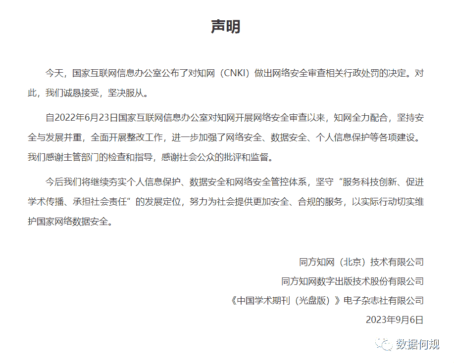
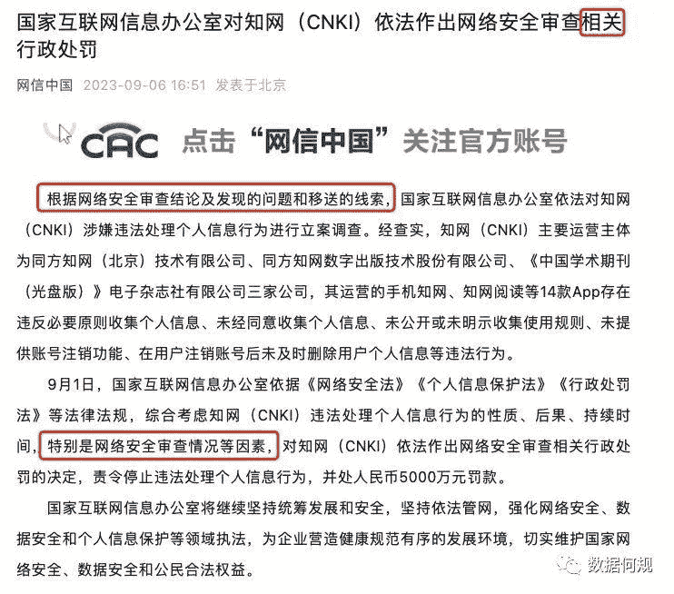

# 网信办知网处罚

> 来源：[https://docs.feishu.cn/docx/YJAQdwcT9ozJHSxmNnVcrzdNnJc](https://docs.feishu.cn/docx/YJAQdwcT9ozJHSxmNnVcrzdNnJc)

**-问：**求国家网信办对知网（CNKI）依法作出网络安全审查相关行政处罚，为啥网络安全审查查出一堆个保的问题？

**-答1：**针对数据处理活动，审查重点为：核心数据、重要数据或者大量个人信息被窃取、泄露、毁损以及非法利用、非法出境的风险。网络安全审查的重点似乎是这个。

**-答2：**《**网络安全审查办法》**第二十条 当事人违反本办法规定的，依照《中华人民共和国网络安全法》、《中华人民共和国数据安全法》的规定处理。因为要罚5000万，没有一部法律能像PIPL一样罚得高。

**-答3：****网络安全审查**过程发现其他问题，可以同时开展检查呀。滴滴之前也是这样的，“根据网络安全审查结论及发现的问题和线索，国家互联网信息办公室依法对滴滴公司涉嫌违法行为进行立案调查。”

**-答4：**看措辞，它网安审查还是有问题的，只是这份公布里无法公开？

**-答5：**重点可能在“**相关**”

**-答6：**对于“网络安全审查相关行政处罚”，左晓栋认为，“相关”二字非常重要。通报指出，根据网络安全审查结论及发现的问题和移送的线索，国家网信办对知网涉嫌违法处理个人信息行为进行立案调查。详见：国家网络安全审查又出重要消息，但这一次是考语文

**总结：答案看这篇：****国**家网络安全审查又出重要消息，但这一次是考语文。

[网络安全](https://cbe8t1r4a5.feishu.cn/wiki/JlMowQsxWi70K7kDOoBcsB4FnGk)