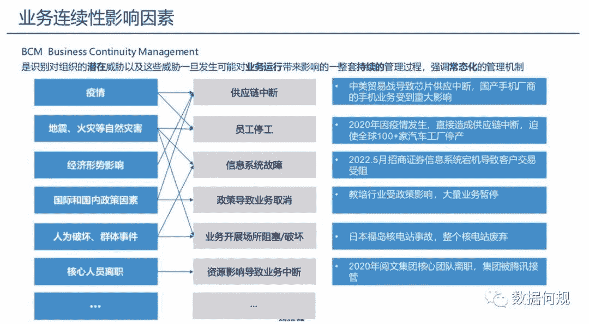
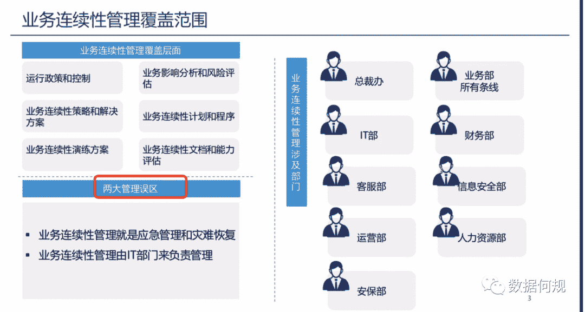
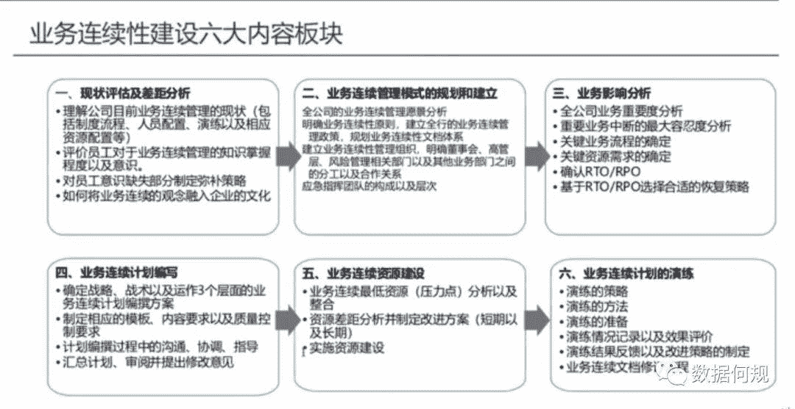

# 业务连续性谁牵头

> 来源：[https://docs.feishu.cn/docx/EVrldwxaIoUsO9xU2J1czmCbn5f](https://docs.feishu.cn/docx/EVrldwxaIoUsO9xU2J1czmCbn5f)

**-问：**最近被频繁询问业务连续性保障是不是安全这边负责，可实际工作中其实业务连续性保障都是运维负责支持的。但是国外的ISO27001把业务连续性是划入安全范畴的。包括国际最知名的CISSP认证，也对业务连续性有一个章节的考点。估计就是这个规范把大家带沟里去了。

**-答1：**27001中的业务连续性，可以是：安全业务连续性，也可以是ISO23301 中的一部分。完整的业务连续性不仅仅是IT还有主营业务。

**-答2：**前期了解了下银行一般是风险管理部负责，特别是负责操作风险的团队负责。详见：《商业银行业务连续性监管指引》。

**-答3：**业务连续性重点是保障业务，IT只是支撑部门，牵头不应由IT。

**-答4：**业务连续性是操作风险，银行里确实一般由风控部门管理。

**-答5：**iso有个特点是可裁剪，可以框定范围IT层面的业务连续性。由IT部门负责管理并无不可。关键看企业的组织架构和各部门职责。

**-答6：**安全管理体系保罗万象，其中很多工作涉及大量的跨部门协调，落地实施层面除了安全团队，还需要这些部门配合实施，包括业务连续性管理BCM。网络系统运维方面的业务连续性保障是BCM的一个重要方面，但不是全部。如果公司按ISO27001标准建立并维护信息安全管理体系，在业务连续性这个话题上，安全和运维团队各有各的侧重。在具体的网络系统运维、网络系统可用性保障、应急响应及演练等方面，安全团队可按ISO标准要求制定业务连续性总体要求并提供相关指导与配合，具体实施一般以运维团队为主。

**-答7：**我在上个东家最不解的是为啥曾经BCP放在法律合规部管了。大水冲了职场，新冠疫情，机房失窃，黑客攻击，客户到门店静坐……法律合规部能牵头做点啥？后来发现这牵头统筹的活儿好像谁都能干，重点在逻辑顺序、职能分配。

**-答8：**业务连续性一般三个部门共同管理比较好，业务部门、风险部门和总管系统的技术部门。监管规定只对商业银行有要求，其他金融机构怎么做其实很迷每家都不同。

**-答9：**或者说看操作风险放在哪个部门下面啦，有些金融机构是放在合规部下面的。

**-答10：**不同的公司组织架构情况不一样，相似职能的部门在不同的公司可能部门名称不一样，职责及工作侧重也不一样。有的公司甚至没有专门安全部门，可能就让IT兼着把安全的工作也干了。有的公司IT和云端是两个部门，前者只管办公网相关的工作，后者侧重生产网络的管理维护。这种情况下，IT和云端都会需要参与到BCM中跟网络系统连续性、可用性保障相关的工作中。

**-答11：**证券12月刚出了一个指南。不过为了跟银行区别改名叫信息技术服务连续性。

**-答12：**感觉如果是JRT标准的话属于有能力做就做的性质。

[数据安全](https://cbe8t1r4a5.feishu.cn/wiki/VzwowBs6ciLnAZk859BcEOO6nIh)