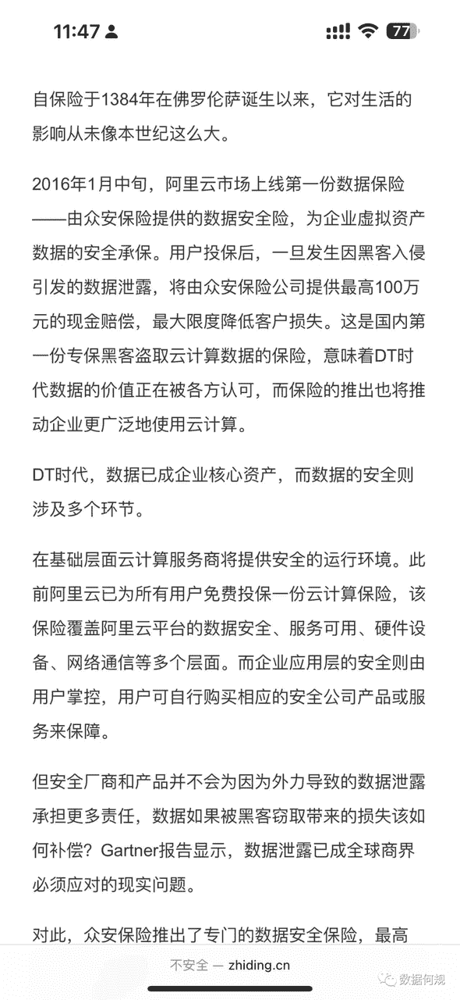
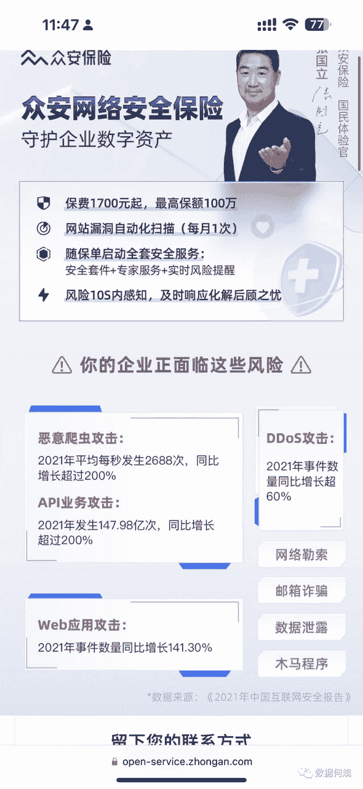
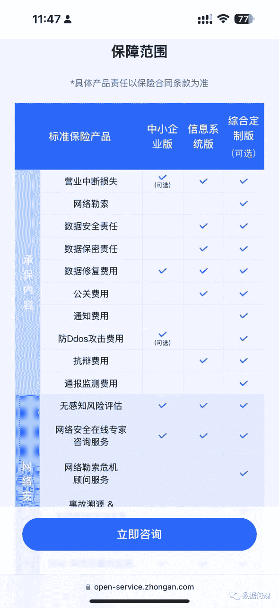

# 数据安全保险

> 来源：[https://docs.feishu.cn/docx/FVs6dNZFXoXd47xyndGcKC5qnzc](https://docs.feishu.cn/docx/FVs6dNZFXoXd47xyndGcKC5qnzc)

**-问：**国外有无个人信息泄露方面的保险？某公司出现数据泄露事件后产生的个人索赔/合同相对方追偿/监管罚款可以由保险公司赔偿一部分？

**-答1：**有的，众安。

**-答2：**国外大的保险集团都有这方面的产品，但投保要求比较高。针对国内企业需求，目前大保险集团的口径都比较严，承保意愿不强，顾虑非常多。

**-答3：**美亚也有类似的产品，https://www.aig.com.cn/content/dam/aig/apac/china/documents/brochures/sr10.pdf。

**-答4：**网络安全和数据责任险单买，有的PI可以覆盖部分。之前接触过的新加坡客户有的还把数据责任险列为合同义务。

[数据安全](https://cbe8t1r4a5.feishu.cn/wiki/VzwowBs6ciLnAZk859BcEOO6nIh)