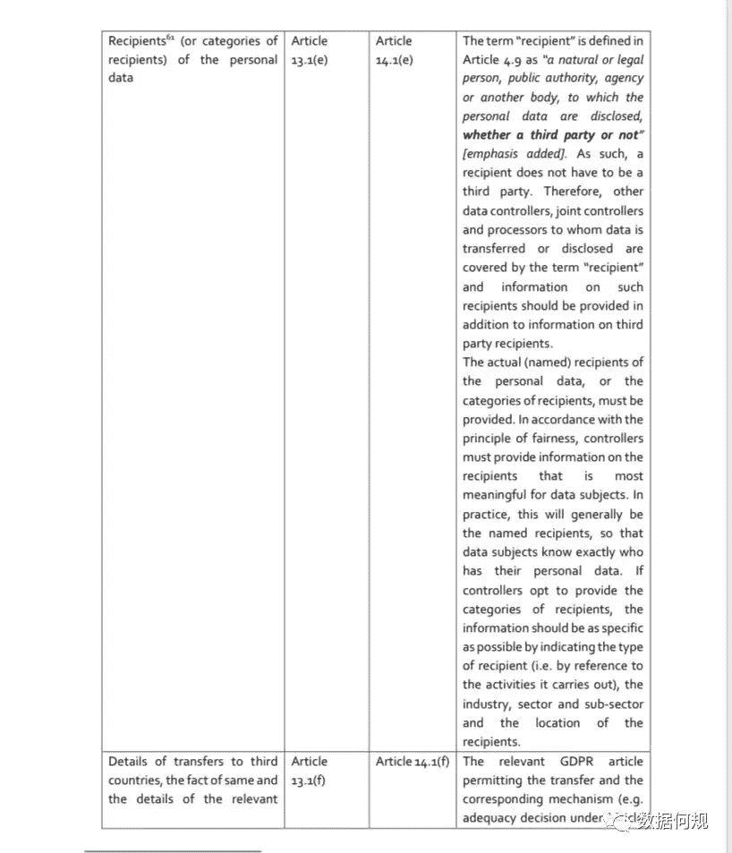
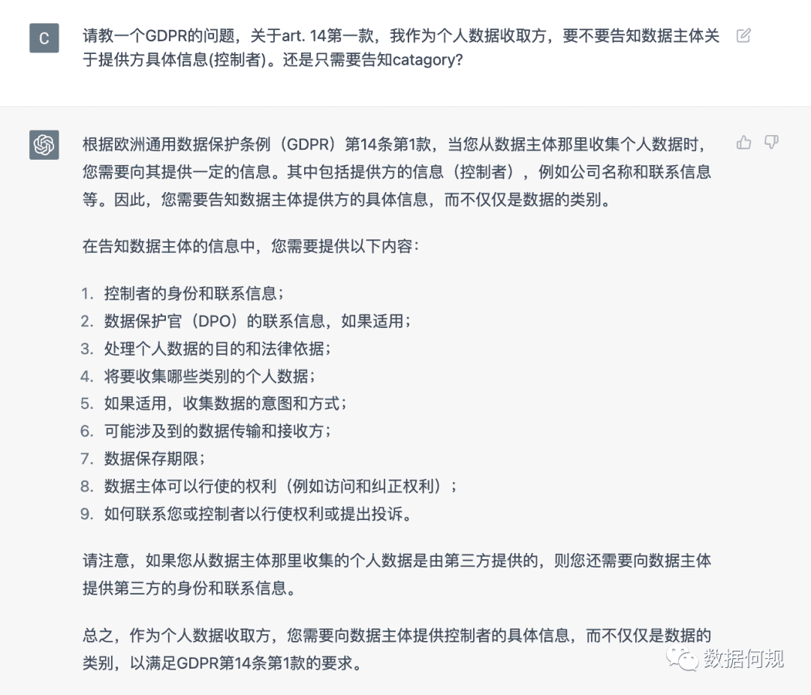

# GDPR A14（1）的告知

> 来源：[https://docs.feishu.cn/docx/EUvRdxRIiowYqPx4TQsc7bTCnjd](https://docs.feishu.cn/docx/EUvRdxRIiowYqPx4TQsc7bTCnjd)

**-问：**请教一个GDPR的问题，关于art. 14第一款，我作为个人数据收取方，要不要告知数据主体关于提供方具体信息(控制者)。还是只需要告知catagory?

**-答1：**在第14条下可以选择告知类别，但是有具体程度的要求（见29条透明性指南，WhatsApp案等涉及的透明性案件也有引述）。在第15条下则是一般需要告知具体信息。

**-追问：**您觉得个保法 23 条下的告知同意，现在实践中能否实现

**-答2：**问题重大，远超学力。如果还是GDPR下的告知问题，基本可以看Meta。IAB广告生态最近的整改也是对应于高监管水位的实现。如果是个保法下的告知问题，印象中群里讨论过告知同意指南，里面应该有相关内容。群里也有很多专家。

**-答3：**Chat GPT的回答。

**总结：告知同意，落地难。**

[欧盟](https://cbe8t1r4a5.feishu.cn/wiki/wikcn3Z7BUSRoMENb8QUxgwNJOf)