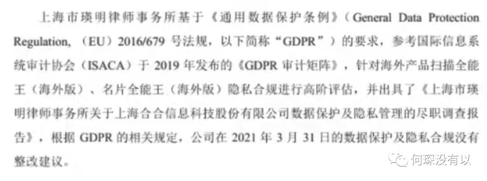

# 境内律师可以就企业GDPR合规情况发表法律意见吗

> 来源：[https://docs.feishu.cn/docx/Qf7UdEuZKoIDZsxxYNwcNQa8nSb](https://docs.feishu.cn/docx/Qf7UdEuZKoIDZsxxYNwcNQa8nSb)

**-问**：想问问大家，境内律所提供境内上市公司法律意见的，能对拟上市公司的数据业务是否符合GDPR进行核查并发表意见吗？

**-答1：**这个做不了吧，**得找欧盟法律师**出意见。

**-答2：****实践中可以**，只要你会。

**-答3：**我也是看到**合合**的这个例子恍惚了一下。

**-答4：**DD Report & legal opinion 还是不太一样的。

**-答5：**有的律所明确给提供数据保护官服务，新加坡PDPC甚至有具体的Data Protection as a service(DPaas)服务推荐，但国内的个人信息保护责任人应该和这种outsourcing DPO function不是很匹配吧。

**-答6：**不太匹配，国内DPO需要对公司负责。不过确实有律师在给境外公司做境内代表。

[欧盟](https://cbe8t1r4a5.feishu.cn/wiki/wikcn3Z7BUSRoMENb8QUxgwNJOf)