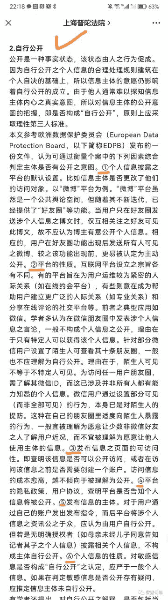
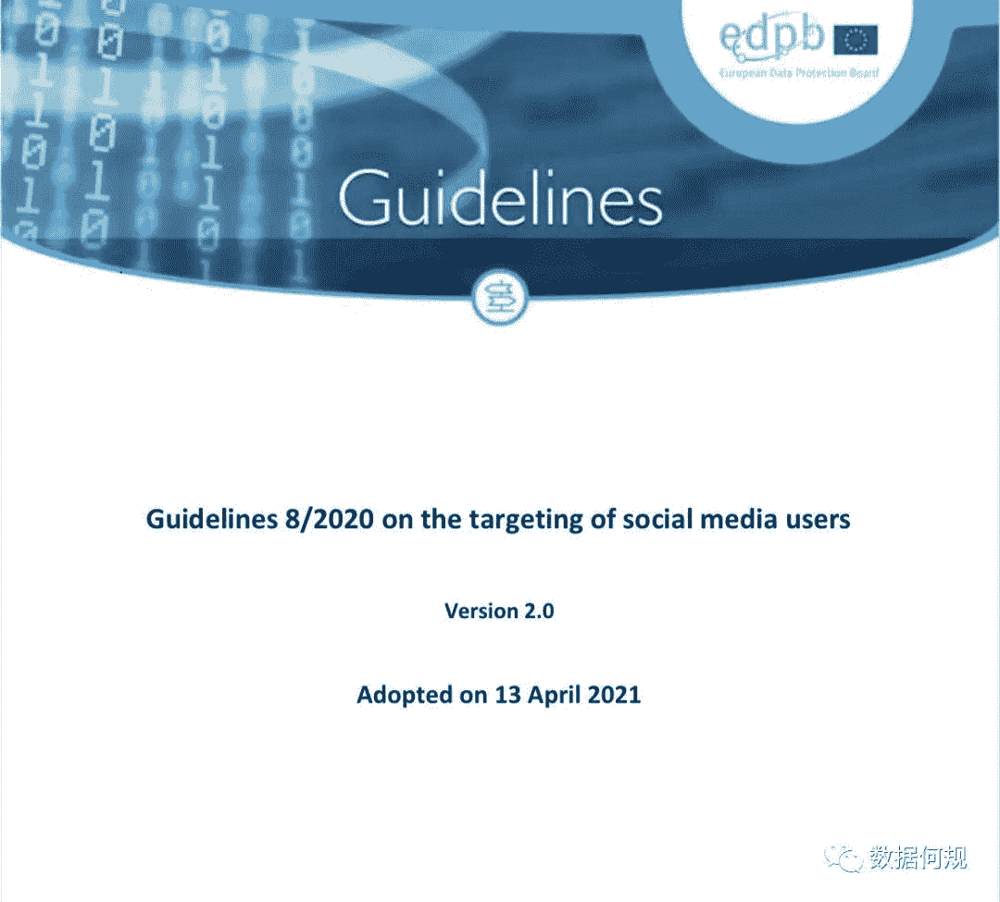

# GDPR下合理处理公开信息的合法性基础

> 来源：[https://docs.feishu.cn/docx/PjY9dYENzoUK1hxDO4hcuQfRnmF](https://docs.feishu.cn/docx/PjY9dYENzoUK1hxDO4hcuQfRnmF)

**-问：**公司社交媒体帐号转发公司客户上传的照片，照片内容是客户使用该公司产品的场景。“转发照片”行为是否需要取得同意？GDPR项下 这个情况使用哪个合法性基础？

**-答1：**合法利益，不过客户上传的时候不就是同意吗？ 这个时候我理解已经有合法性基础了。应该不用重新获得同意，看下目的告知是否可以包括 符合隐私期待。

**-答2：**上传按钮上加个**Agree**。

**-答3：**29条工作组09年的社交媒体数据指南3.3有提到这个问题。虽然还当时没有edpb，也还是dpd，还是有参考价值。简单来说就是需要同意，同时借助类似圈人时提醒一类的功能（Tagging management tools）来拿同意。不过如果涉及的人很多或者社交媒体没有这个功能，还是比较麻烦。

**-答4：**圈人时提醒一类的功能（Tagging managem**ent tools）**，fb上有 但也只是同意了会显示名字链接，不同意照片还是能传，建议不同意的日常戴口罩吧。

**-答5：**用户上传的行为，是否构成**信息主体自行公开**[，可以参考这篇文章提到的衡量因素：论公开的](https://mp.weixin.qq.com/s?__biz=MzU3ODM0OTcyNw==&mid=2247599774&idx=1&sn=c8ad22867b4ee1b7d172e484a51652f6&scene=21#wechat_redirect)个人信息的合理处理——城市数字化转型中个人信息保护与大数据应用的冲突与规制。

里面提到的edpb文件，初步判断是这一篇（P35）。

[欧盟](https://cbe8t1r4a5.feishu.cn/wiki/wikcn3Z7BUSRoMENb8QUxgwNJOf)