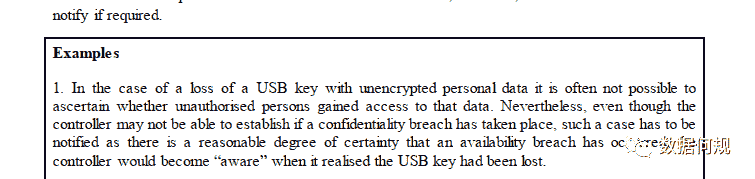
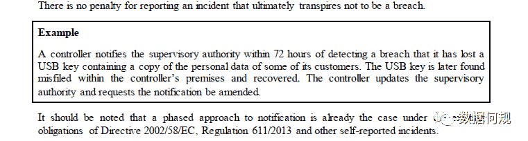

# GDPR数据泄露报告DPA

> 来源：[https://docs.feishu.cn/docx/UX4CdXXxCoblJWxnhklcBDbPnvX](https://docs.feishu.cn/docx/UX4CdXXxCoblJWxnhklcBDbPnvX)

**-问：**请教GDPR Art.33个人数据泄露时报告义务的问题。Art.33要求有泄露的可能性就要报告，还是要确认泄露事实发生呢？例如员工把公司存储的个人数据拷走打算泄露，但又浪子回头并删除了拷走的数据。这是Controller是否要报告DPA？

**-答1：**可以参考一下**Guidelines on Personal data breac**h notification under Regulation 2016/679。

**总结：先报，可以再修正。**

[欧盟](https://cbe8t1r4a5.feishu.cn/wiki/wikcn3Z7BUSRoMENb8QUxgwNJOf)