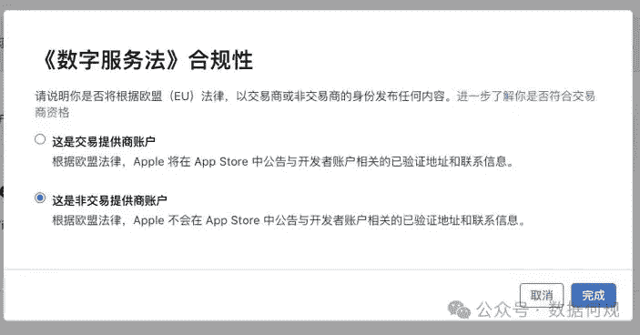
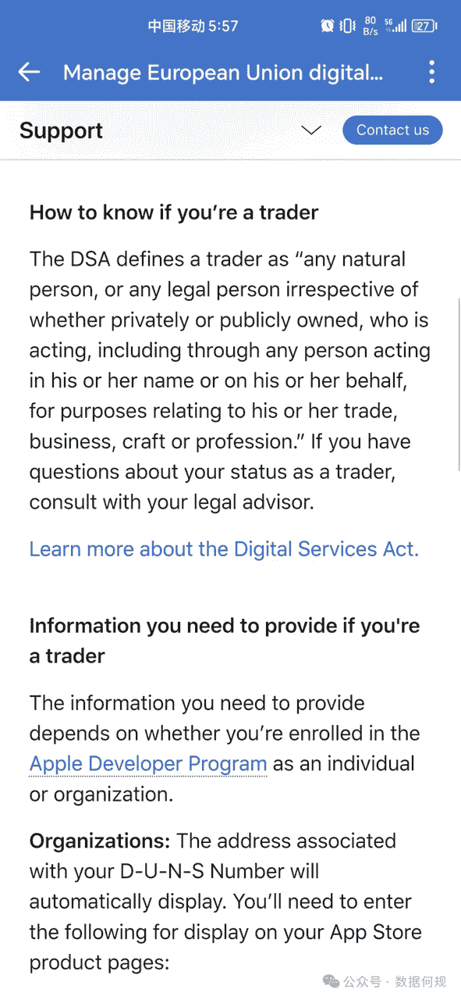

# DSA交易商认定

> 来源：[https://docs.feishu.cn/docx/T8akdsqSjohB87xa8bJcEZKpnqe](https://docs.feishu.cn/docx/T8akdsqSjohB87xa8bJcEZKpnqe)

**-问：**请教下有没有最近欧盟的数字服务法案，苹果开发者这怎么处理？

**-答1：** 只要你卖商品或服务**收钱了**就是交易商trader，叫seller也可以，要做KYC（know your client）

**-答2：**得**具体根据**自己的场景判断下是否属于trader，见：如何判断令人疑惑的交易商（“Trader”）。-答3：可以看看这张图。

**-答4：**也可以看看这篇：数字新章：欧盟DSA“交易提供商”的辨析

**总结：**如果站在一个“不懂法”的小白角度，Trader（交易提供商）这个概念最早出现在消费者权益保护领域，是和Consumer（消费者）相对应的。站在一个善良公平的角度，你思考一下你的用户是否能作为你的消费者，双方是否能形成一种不平等的商业关系，也能对Trader有一个大致的判断了。

[欧盟](https://cbe8t1r4a5.feishu.cn/wiki/wikcn3Z7BUSRoMENb8QUxgwNJOf)

[APP](https://cbe8t1r4a5.feishu.cn/wiki/wikcnm7SSi199OdP5q0UAot3Fsf)