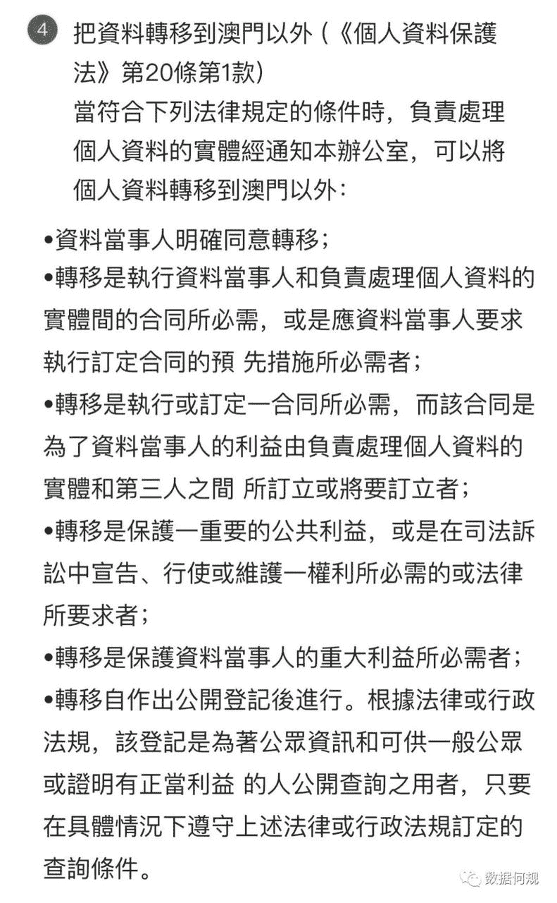

# 澳门个人信息出境要求

> 来源：[https://docs.feishu.cn/docx/KKODdvpCJobPNKxAcYtcrA4Un5d](https://docs.feishu.cn/docx/KKODdvpCJobPNKxAcYtcrA4Un5d)

**-问：**弱弱请教澳门个人信息出境的要求除了个人资料保护法还有别的么？

**-答1：**如果仅限于个人信息，那就是**澳门个资办**的备案。有个回执一样的letter，然后申请表右上角戳个“DDMMYYYY 登记”的字样。

**-答2：**有出通知要求的 看下他们官网：**https://www.gpdp.gov.mo/zh_t**w/law_routine_3.html。不是所有的都要备案吧？

**-答3：**基本上服务器或云在大陆或香港，然后向澳门本地居民收集了信息，都需要。

总结：较《个人信息保护法》简单多了。

[港澳台](https://cbe8t1r4a5.feishu.cn/wiki/CfL5w7AIiih0V4kNAyFcj5Ibn1b)