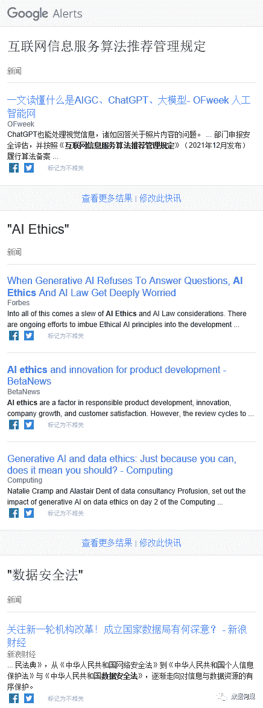

# 数据合规资讯网站汇总

> 来源：[https://docs.feishu.cn/docx/HEbcdtRSboZmQlxtnCHcCGa4nld](https://docs.feishu.cn/docx/HEbcdtRSboZmQlxtnCHcCGa4nld)

**-问：**请问有没有专门发布数据或ai监管领域新闻的网站？最好是国外的。

**-答1：**iapp yyds，不过访问速度比较慢，自备科学上网工具。https://iapp.org/news/

**-答2：**https://www.dataguidance.com/，onetrust也可。

**-答3：**Iapp最近出了AI governance Center，也可以订阅了。

**-答4：****dlapiper**的话，适合综合看一下各个司法辖区的情况；不过他们更新间隔比较长。

**-答5：**用**Google Alert**。

[其他国家/地区](https://cbe8t1r4a5.feishu.cn/wiki/wikcn3WFjwJky6fZB5JxFbYxc0e)