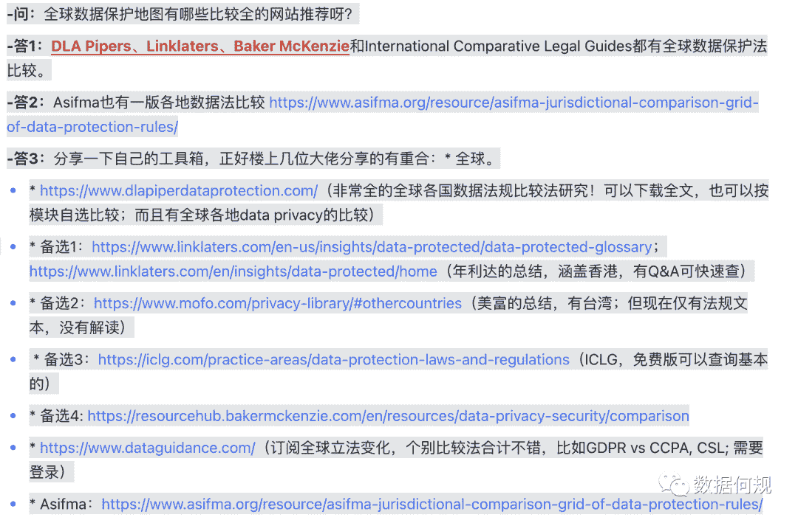

# 东南亚、阿联酋地区隐私白皮书

> 来源：[https://docs.feishu.cn/docx/LtEhdiD3doSIXGxhHwecx2Sdnxd](https://docs.feishu.cn/docx/LtEhdiD3doSIXGxhHwecx2Sdnxd)

**-问：**请问有东南亚、阿联酋这些地区的隐私报告/白皮书之类的参考材料吗？

**-答1：**云厂商的**信任中心**，如：https://www.huaweicloud.com/intl/zh-cn/securecenter/resource.html。

**-答2：**看看这个：https://u.ae/en/about-the-uae/digital-uae/data/data-protection-laws。

**-答3：**搜DLA Data protection，有一个专门的页面可以搜各国数据法简介。

**-答4：****UAE比较复杂**，阿布扎比和迪拜有自己的规则，最好和本地顾问多确认下。

**-答5：**UAE有7个小国吧好像。

**总结：还有下面这些供参考。**

