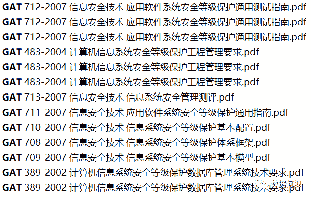

# GA标准有带T的吗

> 来源：[https://docs.feishu.cn/docx/IqvsdvUtqop6MWxcQE3cYYcFnVe](https://docs.feishu.cn/docx/IqvsdvUtqop6MWxcQE3cYYcFnVe)

**-问**：公共安全行业标准是不分T和非T的吗？那么效力上和GB类型的是更弱一些吗？

**-答1：**GA也有推荐性标准的，如下图。

[标准](https://cbe8t1r4a5.feishu.cn/wiki/PZTBw7omjiUoYokJ6G6cCmLynIe)