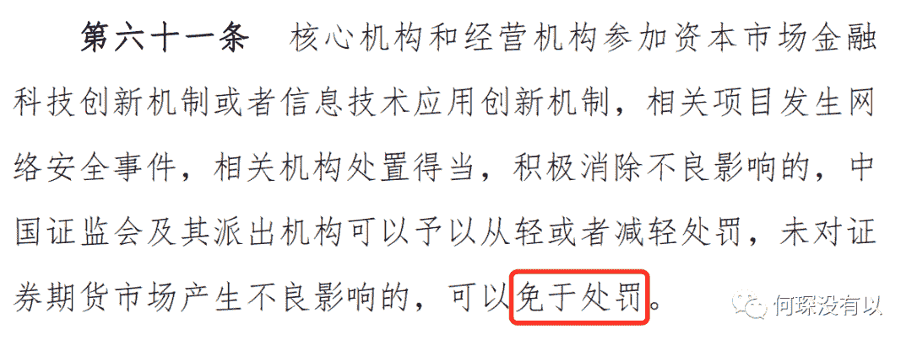

# 免于处罚与免予处罚的区别

> 来源：[https://docs.feishu.cn/docx/FyjpdbhQboNoAMx6o7KcJcbxnee](https://docs.feishu.cn/docx/FyjpdbhQboNoAMx6o7KcJcbxnee)

**-问**：有下面这个条文是病句吗？检索了一下，法律中几乎都是用“免予处罚”。

**-答1：**我理解这里主要看**主语**，如果主语是监管机关，那么应该是“免予处罚”，如果主语是经营机构，那么可以是“免于处罚”，从这个出发，考虑到前句是“未对证券期货市场产生不良影响的“，主语可以理解为是经营机构，那么表述为“免于处罚”应该问题不大。

[其他](https://cbe8t1r4a5.feishu.cn/wiki/SXbUwAgbBiqDNfkMrAzcVQuDnVz)