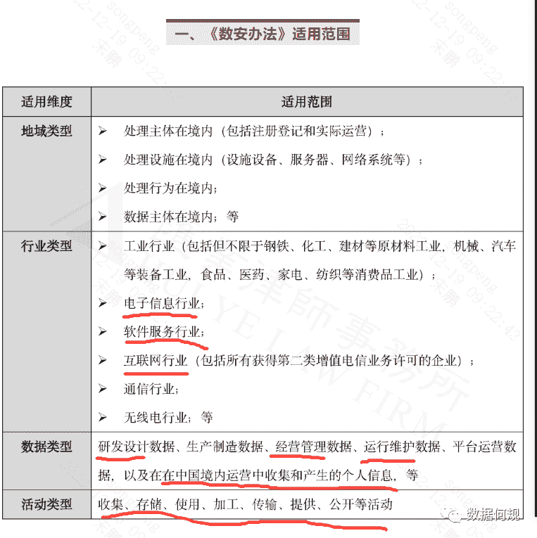

# 《工信数据安全管理办法》适用范围

> 来源：[https://docs.feishu.cn/docx/ABkZdzWofoy0JlxelAwcO6HWnHc](https://docs.feishu.cn/docx/ABkZdzWofoy0JlxelAwcO6HWnHc)

**-问：**看完这篇《工业和信息化领域数据安全管理办法（试行）》法律适用及主要合规义务，有一个疑问金融机构的全资信息技术子公司，受此办法规范性文件约束否？比如，平安科技，中银科技，建信科技……xx科技等等。找不到不适用的理由。

**-答1：**根据上周的讨论，有ICP的都要适用。

**-追问：**ICP备案还是许可。

**-答2：**这个是ICP许可，ICP备案不是一个行业或者领域的准入。

**-答3：**App都通报，但上述金融科技公司的重要数据可能不是报给工信部，而是给人行。

**-答4：**只要属于增值电信业务，都受本办法调整。

[其他](https://cbe8t1r4a5.feishu.cn/wiki/SXbUwAgbBiqDNfkMrAzcVQuDnVz)