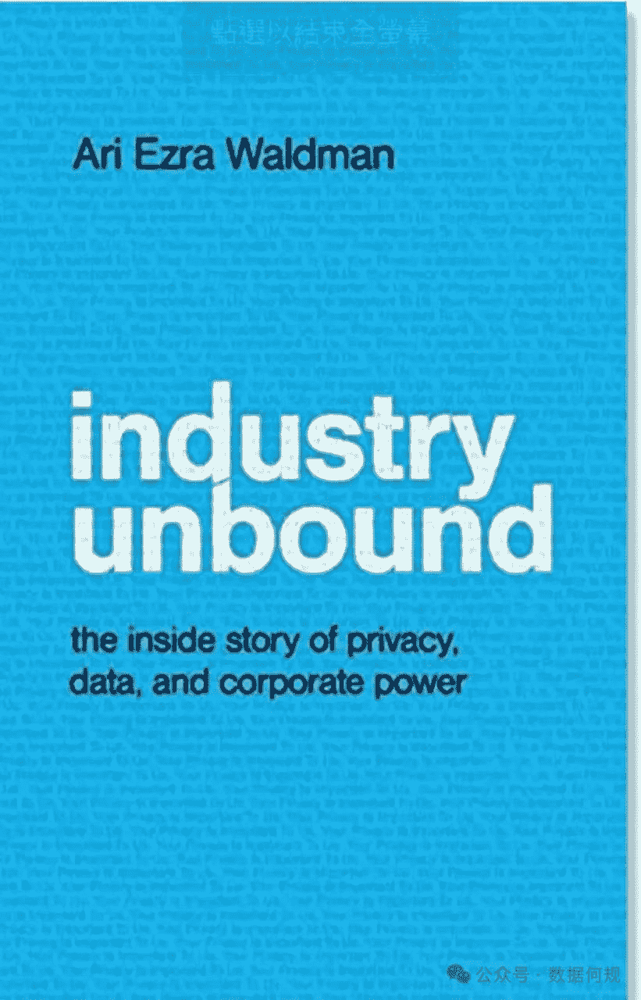

# 数据合规书籍推荐

> 来源：[https://docs.feishu.cn/docx/KdZrdfI2boNVNbxbnuecp7ilnGj](https://docs.feishu.cn/docx/KdZrdfI2boNVNbxbnuecp7ilnGj)

**-问：**今天世界读书日，最近朋友们有啥比较好的数据合规书籍推荐吗？

**-答1：**这里有一些：【超级推荐】数据合规不可错过的一份书单……

**-答2：**每年安利一次的书，明年可能会有中文版。个人信息保护很多时候就是那么难。

**-答3：**上面这本隐私合规从业者读完可能会产生职业倦怠哈哈 需要一颗强大的内心。推荐配合朱老师翻译的《隐私为什么重要》一切阅读，对冲上本的虚无感。

**总结：好好学习，天天向上。**

[阅读](https://cbe8t1r4a5.feishu.cn/wiki/SGrxwFQj1iD8zvk5HeackN5VnBf)